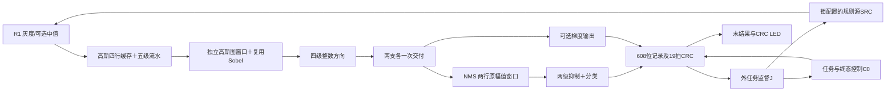

# R2 当前模块代码、中文操作与单测阅读入口

2026-10-06。用户已于2026-10-05批准 R2 流段 v1、48输入及本批本地审计例外。R2 v1 流段的软件验证及 bit/hex 登记已完成（230/230必要case）；最新交付见同目录 DELIVERY.md。下方保留历次检查的原时态；完整赛题整包尚未完成。

## 先看数据走向

图中各模块已有真实源码连接。当前13份R2 RTL包括12个module和1个公共包；另只读复用R1的6份前端RTL与1份复位RTL。配置及三ID在任务快照中保持，各模块交接以沿前 valid && ready 为准。即使同一拍计算多个阶段，非阻塞赋值读取的是旧寄存器，不是这一拍刚算出的值。31个计划业务文件已写出（13 RTL、3参考、2 runner、3工程、10 TB）；完整验收仍须下列实际测试闭合。

## 再看局部语句和交接

| 模块/源码 | 内部阅读顺序 | 参数和易错点 |
|---|---|---|
| [gaussian5x5_pair.sv](../rtl/r2/gaussian5x5_pair.sv) | 受限input_q/row及phase → 八个RAM → select_five_rows → V1/V2 → 四列历史/select_five_columns → H1/H2/H3 → WAIT_EOF | 静态偶W6…1920/H5…1080；纵轴不提前除16；最终总和加128再右移8；BOTTOM0/1只读，TAIL不是新像素；所有级共advance |
| [gradient_direction_pair.sv](../rtl/r2/gradient_direction_pair.sv) | validate_input → 独立error_slot → direction_pipeline D1/D2/D3/D4 | 每lane Gx/Gy signed11；先扩12取abs，合法±1020/L1≤1530；424=384+40；DERR持有期间禁新D1，flush不能删错误 |
| [canny_fork_pair.sv](../rtl/r2/canny_fork_pair.sv) | held_pair/coordinate → 两pending → format_branches → branch_obligations | N接收只清N，grad接收只清grad；同沿新输入在旧clear后写pending；retain0不等grad_ready；没有组合透传 |
| [nms_window_pair.sv](../rtl/r2/nms_window_pair.sv) | 本地游标 → 八个byte RAM → 延迟旧pending写 → select_vertical_history → 三列历史 → 两窗输出 | 每lane16包含M11/dir2/高3零；外框原幅值保留；同步读值下一advance使用；跨行q0先交旧行右边再建新历史 |
| [nms_classify_pair.sv](../rtl/r2/nms_classify_pair.sv) | select_neighbors → N1锁中心/邻居/阈值/位置 → N2用旧N1比较 | 窗a最低16、e为中心；中心>负邻且≥正邻；外框最后抑制；强边>TH、弱边TL<M≤TH；两级整体停顿 |
| [canny_stream_controller.sv](../rtl/r2/canny_stream_controller.sv) | 七状态/ctx与held FJ → collect_old_state_events → reason优先级 → task_lifecycle → STATUS | 同沿FS核旧计数+fire；每口独立游标；原因首次锁、mask继续累积；FS/DERR不等data empty；cancel持续高也能结束；CS全部592位保持 |
| [canny_stream_top.sv](../rtl/r2/canny_stream_top.sv) | 原FE端口 → Gaussian → canonical_sobel_input → 新窗口/复用Sobel → D/FK/N → 八event_fire/metadata → C0 | 只用旧ABORT的data_flush门控私有ready和valid。raw G8仍送C0；S窗口寻址取q/row，末组done关闭新输入，不借坏坐标访问RAM；Sobel三个22位诊断按lane重新拼66位 |
| [r2_pattern_pair_source.sv](../rtl/r2/r2_pattern_pair_source.sv) | 锁pattern/fault → rgb_pixel → make_candidate → source_owner | 两lane、每lane低B中G高R；只真实fire推进q/row；source_stop在沿上注册撤candidate；接受总数仅由J拥有，源不重复存21位计数 |
| [r2_job_controller.sv](../rtl/r2/r2_job_controller.sv) | k生成合法CJ → 阈值映射 → terminal_candidates_before_fire → outer_job_lifecycle | J只拥有外任务/source计数，不存第二份完整CS；同CS fire前组合核J/K独立账；普通complete与预期源故障fixture分开；observer sticky先cancel，等终态CRC后ERROR；FFFFFFFF不回绕 |
| [r2_result_crc_observer.sv](../rtl/r2/r2_result_crc_observer.sv) | select_one_type → check_actual_data → capture608 → crc_chunk → record_owner/last_* | CS优先，rr只data fire改变；每条e0捕获、e1…e19处理；e19必须提交new_crc；terminal_cs与last_cs分别保存，job_start不清旧last；高padding为零，错误data也保留真实record后停止新data |
| [r2_led_status.sv](../rtl/r2/r2_led_status.sv) | last flags/CRC → enable_count → crc_bit | LED0只表正常完整fixture；LED1每250000core沿滚动一CRC bit，同域enable，无分频clock |
| [r2_algorithm_top.sv](../rtl/r2/r2_algorithm_top.sv) | reset_adapter → J/SRC → stream → K → LED | 仅clk_25m/key1_n/led0/led1四pin；源码默认1920×1080，未装摄像头/DDR/HDMI；真实生产外围另属于后续任务 |

位序集中在 [r2_protocol_pkg.sv](../rtl/r2/r2_protocol_pkg.sv)，详细合同仍以批准的R2 v1 D/E为准。Gaussian/NMS及S调用方的RAM地址都取本地受限游标；C0实际检查原metadata，不能用重建坐标掩盖错误。各源码首注释映射到获批的SI/OBS要求和中文步骤。

## 局部之间怎样交接，再看内部细节

1. J在START保持CJ，真实CJ fire同时初始化SRC/K；C0随后ARM共同start、WAIT_FE接FJ，再到RUN允许首FP，不能一沿透传三个事件。
2. FE交Msrc137，Gaussian交G8；top的g_metadata保留原121位，S调用方只给共享窗口规范地址和marker。G8真实fire同时推进S游标及C0对应口账，不另造一次接受。
3. Sobel输出GX/GY/L1三个pair，各自两段11位，重组为两个33位lane。D1先扩12检查，坏组计真实S口但不进D2，另保留120位错误槽，flush不能清掉该槽。
4. fork每支各一次；class/grad由K独立仲裁反压。G/S/D/FK/N私有clear由旧ABORT驱动，触发错误的沿上旧fire照计。原FS独立保存，失败只公布真正交付过的前缀。
5. C0锁592位CS，K捕获时还锁当前J组合终态候选。K发现CS与data共存时掩掉两flags；后19个CRC沿只用捕获的608位及独立terminal_cs，不读已经释放的C0端口。
6. 最后chunk提交new_crc xor FFFFFFFF及last_cs/flags，产生注册done；J在下一沿处理旧done，才能进入下一START。共同rst允许撤所有旧候选，不输出旧任务CS。

语句组织上，always_comb只形成当前候选/比较/ready，always_ff拥有状态和快照；同域握手、复位优先级与同沿赋值顺序分开写。累加先22位、坐标lane加法先12位、梯度显式sign_extend，不靠截断得到期望数值。RAM只清有效性/历史，不清内容；新start重新建立有限图历史。

## 已运行的单测及证据

| 家庭 | 实际结果 | 结果入口 |
|---|---|---|
| 方向 U-D001…049 | 49通过；包括9次坏值/错误槽持有及恢复、一次flush保错 | [r2_units_004](../sim/r2/runs/r2_units_004/suite-result.json)；该run后续因fork波形路径错误整体FAILED，49条D结果单独有效 |
| 分支 U-F001…006 | 6通过；两支独立反压、同沿替换、关闭grad、flush旧交付及恢复 | [r2_units_005](../sim/r2/runs/r2_units_005/suite-result.json) |
| 分类 U-NC001…024 | 24通过；四方向/六profile、阈值相等、高字节、边框及8拍EOF保持 | [r2_units_006](../sim/r2/runs/r2_units_006/suite-result.json) |
| 高斯 U-G001…044 | 44通过；25项黄金、舍入反例、1920×5宽行、四阶段各8拍保持及RAM检查 | [r2_gaussian_001](../sim/r2/runs/r2_gaussian_001/suite-result.json) |
| NMS窗口 U-NW001…012 | 12通过；高低byte/原边框幅值、重放/TAIL/EOF保持、两次不复位恢复 | [r2_nms_window_001](../sim/r2/runs/r2_nms_window_001/suite-result.json) |
| 控制 C0-C01…21 | 21通过；CS逐592位、真实端口账/第一原因、held FJ/CS、取消/复位及21次恢复 | [r2_controller_002](../sim/r2/runs/r2_controller_002/suite-result.json) |
| 真链路 MD001…024 | 24通过；6种raw G8变异×4并发schedule，全部恢复帧逐8口和NW比较；六个ready案各完整8沿命中；真实RAM地址/使能/碰撞检查0错误 | [r2_metadata_004](../sim/r2/runs/r2_metadata_004/suite-result.json)，每案另有独立protocol-audit.json |
| 源 SRC001…004 | 4通过；4×33282pair，共133128组全FP74；258×258、奇半幅/mod256、held配置 | [r2_source_003](../sim/r2/runs/r2_source_003/suite-result.json) |
| 真四pin TOP-S001 | 1个指定case通过：128job含64正常/64源故障，5个warmup完成及k5 CRC忙时KEY低4沿复位；133次终态/CRC独立审计 | [r2_top_small_003](../sim/r2/runs/r2_top_small_003/suite-result.json)及[独立审计](../sim/r2/runs/r2_top_small_003/TOP-S001/protocol-audit.json) |
| 观察器 OBS-B001…014/OBS-R001…024 | 38通过；167个实际完成job、3243条实际608位record、98864位CS及独立CRC；含19个确切chunk复位、CS优先/公平/sticky终态及FFFFFFFF耗尽 | [r2_observer_002](../sim/r2/runs/r2_observer_002/suite-result.json)，每案另有protocol-audit.json |
| V001…012及P-FATAL001…003 | 12类/25子事件全部按真实输入入口拒绝；三个真实TB故意fatal均exit1、非timeout、无成功JSON；不计入230普通case | [r2_probes_001](../sim/r2/runs/r2_probes_001/suite-result.json) |
| HD001真实SRC+C0+算法+K | 1920×1080，k0/median0/retain0；七口各P及NW窗口P，1036801条真实record/592位CS/逐bitCRC全部通过，CRC ee1881f7 | [r2_hd_002](../sim/r2/runs/r2_hd_002/suite-result.json)及[独立校验](../sim/r2/runs/r2_hd_002/HD001/protocol-audit.json) |

目前合计224个不同的指定case通过：181/186 stream及43/44 observer；V/P探针另计。TOP-S另比较1678条真实608位record的逐bit独立CRC、78736位终态（133×592）。HD001首轮因Windows文本换行导致独立审计失败，整个r2_hd_001仍FAILED；记录输出改wb、B011确认CR=0/LF=31后完整重跑。r2_hd_002已完成1920×1080的P=1036800组×七口及NW窗口P，1036801条608位record独立CRC/完整CS均通过，数值/协议/RAM范围/碰撞错误0；20741840模拟沿（0.8296736秒@25MHz）是此可暂停实验配置的实际运行时间，不证明生产视频帧率。

后续还须HD002…004/HD-F001…002/TOP-HD001，共6个指定case、所有结果字段/schema及同源绑定收尾、完整算法到CRC再到LED的有效扇出审阅，以及必要证据齐全后的bit/hex。小图128job不是128个额外case，也不替代生产视频实时吞吐证明。

早期错误保留：001是runner换行语法解析失败；002是两个plusarg未分别括号化而被合成一个argv；004在完成方向家庭后，fork波形脚本误引用out_valid/out_ready而停止。已按实际双支端口修正，未更改算法期望。005开始保存source_snapshot；更早D49以实际输入/黄金hash、工具argv及逐case结果绑定，恢复时逐项复核。

本轮失败也保留：controller001是decimal常量后紧贴问号被Questa词法误读，改为带括号/空格；metadata001暴露输入参考的RGB字节顺序反了，修正为R1的低B中G高R，并新增非对称RGB自检；source001波形误读无in_valid的源端口，修正实际out端口；top_small001的SV decimal宽度填空格致路径不符，改为逐位构造三位数字。未改独立数学黄金来迁就RTL输出。

## 在软件上怎样打开和观察

仿真入口 [run_r2_sim.ps1](../scripts/run_r2_sim.ps1)，使用已安装Questa/Python及现有ASCII work别名。RunId必须新建，诊断CasePattern成功不代表完整套件通过；旧run和日志保持。每case有run.do、trace.wlf、实际argv/退出码和result.json。脚本的onbreak只在TB finished已置1且结果已关闭时返回0，不能用工具exit0代替数值比较。

人工阅读波形可先打开高斯041：看phase/pending、RAM RE/WE/address与H3 valid；方向049看err_valid/payload在flush期间保持；分支004看两支各自交付；再看metadata_004/MD001的raw g_metadata、s_input_q/row、真实event_fire、次沿data_flush及RAM地址；最后看top_small_003/TOP-S001的J k/state、K busy/chunk_index/record_shift、真实CS和last_crc。k5首次busy时KEY低四沿，J重启k0；核e19提交新CRC和随后done，再下一job。默认小图WLF保留这些实际信号；用户尚未提供GUI观察或理解作答，本页不签认人工观察。

Efinity文件：[工程](../project/r2_algorithm.xml)、[引脚](../project/r2_algorithm.peri.xml)、[时序](../project/r2_algorithm.sdc)。20份物理RTL各一次，Ti60F225/I3、SV2009、默认生产1920×1080；J2时钟/1A 1.8V，P13 KEY、N14/P14 LED/BR 3.3V，LED drive4。实际r2_physical_001已Map/Interface/Pnr退出0：布局10106 XLR（16.62%）、26 RAM10（10.16%）、DSP0；map5738 FF/6228 LUT4/1334 ADD/166 SRL8。主STA setup29.956ns、hold0.030ns，40ns约束。

独立postroute_audit_002载入同run真实trace，internal unconstrained/no_clock/multiple_clock均0，clock1。KEY到两个SR精确各匹配1且网络key1_n；Q1→D2 setup39.552/hold0.109ns，Q2→core子集30.637/0.415ns、Q2→RAM定向33.081/1.000ns，说明同步复位路径仍计时。5930 register集合=5738FF+166SRL+26RAM，不是5930FF。只有KEY/两LED分别列为输入/输出delay例外；26 RAM来自FE6/G8/newS4/N8，固定Y_ONLY合法裁剪FE原无用两RAM。实际报告及hash见[physical-audit](../runs/r2_physical_001/physical-audit.json)。仍未完成全面有效扇出审阅及bit门槛，不能称整个R2释放通过。

在Efinity用File → Open Project打开新r2_algorithm.xml（需要ASCII路径时用既有FPGAEdgeLinks/Work别名的同一文件），先看Project/Device的Ti60F225和I3，再核Sources里的20份RTL与top r2_algorithm_top；Interface Designer核四GPIO及两个bank电压。实际构建副本在runs/r2_physical_001/flow/r2/project，可查看其Reports里的Resource/Timing；独立STA覆盖报告在diagnostics/postroute_audit_002/outflow。综合71条warning保留，内容为冗余变量及小/固定数组逻辑映射；wrapper的中文真实路径警告也保留。先核约束和实际资源，再看内部临界路径与复位定向报告，不能凭工具exit0或CRC非零验收。完整必要仿真后才生成登记bit并停止实体操作。

## 双向追踪与下一步

SI-REQ02 → 五算法RTL/本表步骤 → U-G/D/F/NW/NC与二维参考；SI-REQ03/05 → C0/stream/CJ/FS/DERR → C0/MD；OBS → SRC/J/K/reset/LED/top → SRC/TOP-S/B/R及逐bitCRC；SI-REQ07 → 四pin工程/build → 实际Map/PT/PNR/主STA/独立覆盖查询。每个源码和TB首注释可反查批准设计E/G；HD、统一schema/源绑定、有效扇出及bit仍是剩余检查。

下一步完成其余生产配置、真源故障不复位恢复和真J生产顶层；收齐统一schema/当前源绑定及全面有效扇出证据，才开启Bit gate。完整Canny滞后、识别和生产摄像/DDR/HDMI属于后续全任务，保持未完成。

## 获批G范围：输入与退出码探针操作草图（实施前）

2026-10-06，沿用R2 v1 G1/G2/G3，不改变算法或公共接口。输入探针放在既列r2_vectors.py，退出码探针放在既列run_r2_sim.ps1，三个已有TB仅增加FATAL_PROBE入口。先隔离生成一个新probe目录，再给每个V编号制造单一非法输入，调用真实参考/文件预审函数，必须捕获声明的ValueError或已有文件的FileExistsError；意外成功或别类异常均失败。短/长文件采用与坏文件实际hash相同的元数据，让行数检查本身成为拒绝原因；padding/uppercase/XZ也不依赖hash错误拒绝。路径案例分别检查绝对路径、父目录和已有目录，不能真实写出run目录。

P-FATAL001/002/003依次展开高斯、wrapper、观察器TB，传FATAL_PROBE但不生成黄金输入。采用与正常case完全相同的onerror/onbreak finished判断，保存实际argv/stdout/stderr/exit；故意fatal必须非零、非timeout且无finished成功JSON。正常运行与预期失败探针的进程接口共享同一函数，只有明确ExpectedFailure分支允许非零返回；不会把探针记成算法case PASS。先跑探针结果，再运行选定功能case；探针结果绑定本次源快照，历史未执行部分保持未执行。

当前新增观察器TB：先暖机k0/1/2到合法k3，再typed异常或复位，再复位恢复k0。J/K真实组件保留；源事件只是组件fixture。CS仲裁依赖valid组合结果，驱动候选后先稳定再等待接纳沿；CS终结上下文后，同拍未接纳的数据候选允许撤销。取消fixture明确携原FS取消码1，独立参考按该声明检查全部CS592，不套正常FS0。
## 获批HD组合：接线及逐拍操作草图（实施前）

HD001…004和HD-F001…002使用原计划tb_canny_stream_top.sv内独立tb_r2_hd_chain模块，避免MD受限force逻辑进入生产尺寸测试。W/H保持1920/1080，真实SRC、C0及完整算法链、K都实例化；只有CJ由合法TB驱动替代J。CJ接纳沿同时启动SRC/K，后续来源坐标和FP由SRC自行推进；TB不直接填写FP或强制终态。SRC stop按CSvalid注册，下一CJ才清除；故障及恢复间不复位。K候选flags由原CJ、真实源及独立八口账/FS/统计/EOF合同比较形成，再由Python逐592位和逐bitCRC复核。

每个真实event_fire按行优先从完整黄金读取一组，另外NW窗口逐组比较，记录真实CLASS/GRAD/CS的608位顺序；并对28个RAM10的真正RE/WE/address检查范围及同址。完整job每口P、关闭grad为0，fault只比较已交付前缀但RGB必须518402；恢复帧P且身份更换。任何未比较、短文件、重复终态、错误marker或CRC都fatal。LFSR固定0x431；CLASS/GRAD/CS的外部暂停最多8沿，已经向K呈现且未接纳的valid由pending保持，只有真实fire后才能重新选择暂停，不能随随机位撤销候选。

完整尺寸使用流式黄金文件读取和逐行record输出，WLF只保留控制/首末进度，不能记录全RAM内容。TB有限cycle依获批G2；runner每HD/HD-F wall4小时，模型60分钟。首轮采用HD001单案定位，之后补其余5案及不复位恢复，不将单案成功当完整闭环。
## 获批物理流程：runner内部操作草图（实施前）

run_r2_build.ps1按Prepare→Map→Interface→Pnr→Bit独立阶段执行，只接受新RunId和已安装efx_run.py。Prepare从XML实际20份清单解析来源，复制到flow/r2及flow/r1的相同相对树，连同约束/参考/本runner保存hash快照。之后阶段核原批准、48输入和当前/快照/工作RTL/SDC无漂移；Map不生成bit，Pnr只依已成功Map/Interface。工具可以更新flow工程运行属性，因此每阶段另存其前后hash，不把运行属性更新误当源代码批准变化。

Bit还必须读取本run release-gate：230个不同必要case、15探针均真实文件hash有效，当前20份RTL及参考与证据绑定，完整生产尺寸比较量和物理报告通过；物理审查核40ns setup/hold、内部未约束0、四pin及例外、资源≤22000XLR/≤28RAM10/DSP0和有效算法扇出。gate缺项时不启动pgm。真正work_pnr/r2_algorithm.lbf和Interface产物必须同run非空并绑定hash，禁止在空work_pgm返回0就宣生成成功。产物必须bit/hex两份非空，staging登记及事件后停止硬件步骤。本地审计例外只作用这次软件实验，正式数据库/硬件状态不改。

## TOP-HD001与黄金复用：内部操作草图（实施前）

2026-10-06，沿用已批准R2 v1 G1 TOP-HD001/G2，不修改任何生产RTL。既列tb_r2_algorithm_top增加静态HD_MODE：HD分支直接实例化无参数覆盖的r2_algorithm_top，默认1920×1080；小图分支仍6×5，同一chosen.dut层级便于逐口观察。共用实际J/SRC/C0/K、数值账和CS记录，不用外CJ driver。HD只跑reset k0完整job，初始KEY低至少4沿、释放两级后启动；终态CRC后下一J沿必须k1/START，再停止软件测试。小图仍5个warmup、k5忙时复位和完整128job，不删原覆盖。

TOP-HD黄金直接复用已通过HD001的完整8文件及CJ，复制到新run/vectors/TOP-HD001/job000，保留来源manifest和实际参考库hash；禁止重算一份可变化的HD001、修改原文件或引用越界输入。先核原manifest完整、实际HD001 PASS、严格行数/位宽/hash、数学及OBS参考库相同，再复制字节并核相等，复制前后来源hash一致。新run记录这些复用来源的before/after hash。独立校验共用生产全图规则与流式逐bit CRC，另核真实J的owner_drain、k0/LED0及下一沿k1/START。record用wb保持LF；文件名用明确warmup/main分支，避免SV不同长度字符串条件式补空格。有限cycle/wall沿获批G2；完整case不能用小图或仅工具exit0替代。
## 物理扇出审查操作草图（查询前）

PHY-T03读取实际map.v建立按位信号依赖，不改RTL或keep属性。解析顶层原语及assign：LUT4只为LUTMASK真依赖的输入建边；ADD只连接数据/进位输入到输出；FF/SRL仅D→Q；RAM只WD→RD，排除CLK/CE/地址/复位捷径。向量按声明宽度和显式位选展开，逃逸标识符保留内部数组下标，未知表达式或原语立即拒绝，不能静默跳过。图允许跨时序元件，因此只证明结构上存在有效数据路径，不代替周期功能/可达状态证明。分别查灰度/中值、高斯、新Sobel、方向、NMS幅值和四组RAM读出至record_shift→CRC→last_crc→LED1的路径，并核CLASS结果至LED0控制结论路径。保存路径中每个原语/端口/信号及源网表hash；必须用仿真数值结果补充功能证据。
## 2026-10-06：真实生产顶层补证

TOP-HD001（r2_top_hd_001）已经完成并通过独立审计：无参数覆盖1920×1080，真实J从KEY低4沿后启动k0；七必要口各1,036,800组、关闭GRAD为0，NW窗口1,036,800组；1,036,801条真实608位记录，CS592全字段和逐bit CRC一致，CRC ee1881f7，LED0=true，终态采样后真实k1/START。result SHA256 8A95C173268EBB8677DE50EC821FB3148A027A5372D19542D164F4E3D93B975F。记录名已消除空格填充，严格LF文件写入。

真实顶层小图的新回归r2_top_small_004仍含5个warmup、第5任务忙时按键复位、完整128job，全部通过。仅改变测试平台静态尺寸选择和文件名，不改13个业务RTL。当前累计225/230个不同case已有通过证据；正在运行HD002/003/004、HD-F001/002及当前版本绑定回归。不能把正在运行的case计PASS。

生产顶层20741840个25MHz沿对应约0.8297秒的测试壳模拟时间。K每条608位记录分19块计算，串行观察器会反压；该时间不代表摄像头/DDR/HDMI生产系统帧率，尚未完成这些接口，也不作为原项目性能达标声明。

物理数据扇出诊断保存于runs/r2_physical_001/diagnostics/fanout-final-review-001.json，66条按位路径覆盖六算法阶段、全部26个RAM读出口、记录→CRC和32个last_crc位→LED1及CLASS→LED0。只连接真实数据依赖，排除时钟、使能、复位和地址捷径。生产epoch固定1及梯度高位padding使record_shift低位29/30/31始终为0，解释map图仅605个命名记录位；逻辑协议仍608位。该结构结论与真实仿真分列，未生成bit，全部230case及G2字段/当前源码绑定仍需闭合。
## Bit门控内部纠错草图（修改前）

沿用获批G2/G3：JSON布尔值必须真为boolean true/false，字符串、缺字段或null不能靠PowerShell truthiness通过finished/timed_out/physical flags。输入探针除12项声明数量还实际读取result确认PASS和unexpected_accepts=0；每项fatal保留实际非零退出且timed_out=false。Bit工具退出0却缺少非空bit或hex时，先保存实际退出码/完整日志/已存在产物/缺失原因，再失败；不能在写result前throw而丢失工具终态。该纠错只强化既有验收语义，不改变RTL/时钟/接口/31文件或测试范围。当前仿真冻结不含build runner，可独立修改它；下一物理run必须用新runner快照，不借旧runner哈希。
## G2字段审查：适用性与未测量边界（补证前）

逐case结果由原result、manifest、工具exit、源码快照和protocol-audit共同定位，不覆盖原result；不能只把空字段补0再称已测量。W/H、fixture配置和三ID可来自已严格预审的输入，必须注明“输入契约”；accepted/compared/cycles/hold及RAM计数来自TB实际监视；完整逐位payload比较可支持相应输出EOF/marker的派生结论，必须注明“由实际完整比较推得”，不能冒称独立计数器。对reset/故障前缀，只有真正比较的前缀支持派生，不能拿全部黄金假定完整硬件输出。

G与NW有行RAM和阶段状态，结果应声明bank交易计数单位与原语数；D/FK/NC只有寄存器流水，RAM项N/A=模块不实例化RAM；SRC只是图案源，FS/CS/CRC和RAM=N/A=无这些接口/资源；C0只观察组件fixture，完整CS592比较与独立八口账是其结果，不能冒称真实FE或算法图；OBStyped组件没有图像RAM，组件故意字段注入必须明确；MD/HD是真链，使用实际八口账、原FS/CS、原语地址/使能检查。真实TOP-S/HD目前已有数值/CS/CRC/J证据，但原top TB未独立记录RAM使能检查计数，G2该项仍OPEN；待现有冻结仿真结束，补与HD链相同的28个实际原语使能/地址观察及结果字段，再针对TOP-S和TOP-HD重新验证。补观察不改变生产RTL，也不把旧数值通过改写成新观察已通过。

release-gate在这些适用字段未闭合时保留未生成/非PASS。完整230个case的覆盖数量，与必要字段/源码绑定闭合是两件分别可检查的事。
2026-10-06最新检查点为runs/integration-checkpoint-004.json（228/230，SHA A61295C91D17451FE867CAD07945B940F30CF68BFAD63F712C39EBCC8591A3FB）。current stream binding 180案及observer binding 42案已实际完整通过；38个OBS的190份记录文件（含reset前缀3324行）已严格LF再次检查。HD003及HD-F001通过，后者真实坏源终止后不reset恢复完整1080p；HD004与HD-F002仍运行，不计通过。实际会话5657/45085必须继续恢复，不重启或取消；它们完成前所有sim源码、TB、model和sim runner保持冻结。

新r2_physical_002已经Map/Interface/Pnr/PostrouteQuery exit0，实际10106 XLR/26 RAM10/0 DSP，25MHz setup29.956/hold0.030，内部未约束0；全部四pin电气与复位同步链查询、66条真实按位数据路径均已审查。physical-audit.json SHA 15679AB4E57026846E870683B52E32246658CADB73E65276F8F356C4AF4DB2E5。比特流尚未生成；G2字段闭合及TOP RAM真实观察仍待补证。31份业务文件均已生成，13份RTL本轮零修改，完整五基础/六高阶及实体运行仍不是完成状态。
## 控制器与顶层结果补证：中文操作草图（编码前）

本次只修改已批准的 C0/TOP 验证观察，保持生产 RTL、31 文件范围及 G1 场景不变。原 C0 的 check_status 已将实际 CS592 与独立黄金逐位比较，并核八口实际 ledger、EOF、strong/weak 和实际 FS。补证时先打开结果并写 jobs 数组；每次第一次检查该终态时，写当时真实 CJ、FS、CS、ledger 及 EOF/分类计数，再继续原比较和 release_status。C14 的同一 held CS 重检仍执行，结果只记一次；复位中止的 C16 旧 job 不伪造终态。用同上升沿观察记录 cancel 的上升事件、fe_cancel 有效沿、FS/CS fire、stream_start、reset 进入次数；“事件次数”和“有效沿数”分开标单位，不能由场景名称推算。末尾写原有比较量及这些实际观测，关闭 JSON 后才 finished。没有图像算法 RAM、CRC 和 SRC 的 C0 项保留明确 N/A，不能补零冒称已测量。

TOP 复用已验证 HD 链的 check_ram：每个非 reset 上升沿检查四个 G 双平面银行、N 的两组四平面银行、新 S 的两个双平面银行以及 FE 四个双平面银行，共 28 个实际 RAM10。地址只在 RE/WE 真有效时验证小于 W/2；同址 RE+WE、私有银行 data_flush 期间使能立即 fatal。read/write 累加的是平面原语使能次数，checks 是十二组银行检查调用次数，不把两者混为容量。全 case 计数包含 warmup 和 reset 中止前缀；每个 job 另记录 start 时快照到终态的差值。reset 只清 held 观察状态，不清累计证据。

TOP 同时监视真实 FP74、CLASS125、GRAD185、CS592 的 valid/ready 保持；取消/flush 按原协议允许撤销数据，CS 只由 reset 撤销。记实际 job_start、FS/CS fire、terminal_done、source_stop 上升事件及 reset 进入次数。现有逐位黄金、EOF ledger、CRC 记录和 J/KEY 检查全部保留，任何失败保留新 run 并查原因。冻结会话终结且输入守卫核对后才改 TB；先重跑小图 C0/TOP，再启动真未覆盖参数的生产 TOP-HD。纯 TB 变化不改变物理 002 的 27 份冻结构建输入。
TOP RAM 补证首轮 r2_top_observed_small_001 在真实 k64 fault 的停源后报 TOP FP hold，vsim exit1，原失败保留。核对现有 SRC source_owner：source_stop 采样后 active 清零；J 同沿接纳 CS 后离开 owned，下一沿 source_stop 已低，故不能用“当前 stop”延续上一沿已取消的 held 义务。修正草图：检查上一沿 held 时仍照原规则；记录本沿的下一个 old_fp_hold 时同时要求本沿无 source_stop/cancel/data_flush，明确取消这一候选的未来保持义务。正常 stalled candidate 的 payload/valid 检查不变，不改变生产源或接纳规则。等仍运行的 C0 输入守卫完成后才修改 TOP TB；然后新 run 重测全部 TOP-S 128job。