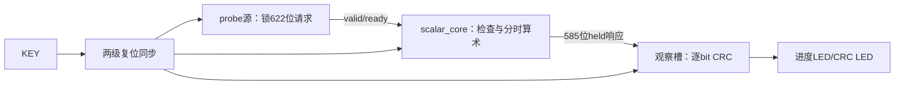

# 算术模块的中文操作、接口与代码追踪

先读批准卡整体范围，再读本目录module-code-reading.md中的局部逐沿草图，最后按下面顺序打开代码。此模块提供kind0–7整数算术；完整角度/拟合/形状识别和整机生产接口仍属后续范围。

## 从整体到语句的阅读次序

| 次序/文件 | 看什么、为什么这样组织 |
|---|---|
| 1 rtl/scalar_protocol_pkg.sv | NUM_ID176、REQ622、RSP585字段位置，kind/outcome/reason及每种合法target；模块交接只用一个消息合同 |
| 2 rtl/scalar_core.sv 端口与组合检查 | 只有旧QUIET给req_ready；握手锁整包。先检查W/H，再版本/owner/kind、flags/target、padding、分母，错误返回次序唯一 |
| 3 core时序scalar_transaction | reset优先、HELD保持、未暴露cancel、普通case。时序用非阻塞赋值，同一沿读旧值；PACK与消费分开 |
| 4 MUL_INIT/PART/EMIT/LAST/DONE | 12×12个16位digit分列相乘，一份16×16乘法复用；37位acc和20位carry；第24word单独发出，完成后才恢复符号 |
| 5 ADD_DIGIT/ADD_DONE | 先组合扩208位、13个16位块带进位；SUB取反加1；结果高位guard核完再符号扩385位 |
| 6 DIV_BIT/CHECK/ROUND | 192次位决策，余数193位；floor商与RNE分开；2r与B比较，half取偶，之后恢复符号 |
| 7 ROOT_PAIR/ROOT_START及multiply_purpose | 96个两位组，floor root96/容器97；复用同一乘法核检查k²、(k+1)²、(2k+1)²，4A保留194位 |
| 8 QUALIFY/PACK/HELD | 先算完整值，后检查target容器；溢出是错误不是截断。已valid响应直到消费保持，取消不撤回它 |
| 9 rtl/scalar_probe_top.sv | 合成请求源LFSR在真实fire后前进，响应槽预留后接收，585位串行观察完成才下一笔；上游/下游不互等 |
| 10 model与tb | Python直接大整数数学；TB采沿前握手、沿后形成，622/585位保持、取消、复位作废与逐位结果各自检查 |

接口手算例：kind3、signed A=−3、B=2、target193。原622位包在e0锁住；e1校验；随后分时求幅度商1余1，half时商奇数加1得到2，再恢复负号−2。target资格通过后形成VALUE/reason0，value在385位符号扩展；下游暂停不会再计算或换身份。若在结果尚未valid时精确ID取消，改交DROP/value0；已经valid时保留原−2交付，由取消方丢弃。

身份顺序低到高：epoch32/frame32/config32/owner8/call_seq64/destination8。尺寸/版本/类型在接受沿快照，计算中不读外部变化。原输入持有至响应交付，私有A/B可以被根内部平方复用，原A不会丢失。冷复位只清资格，数据无需功能清零；调用方与消费者同域共同作废旧在途请求。

## 在软件里操作

1. Efinity打开 `project/scalar_probe.xml`。检查Titanium、Ti60F225、I3、top scalar_probe_top、SV2009，四个RTL文件及scalar_probe.sdc/peri.xml齐全。当前工程是25MHz单时钟算术观察实验。
2. 仿真在已存在本机工具环境使用scripts/run_scalar_sim.ps1，RunId必须全新，Suite=All；不得覆盖旧目录。默认产生完整向量、core与probe结果、独立audit、真实退出记录和probe.wlf。失败看对应stdout/stderr，旧失败保留。
3. Questa波形加载通过run的probe.wlf。先看KEY/core_rst和reset_adapter两级；再看source_state、request_slot、req_valid/ready、arithmetic/state、rsp_valid/ready/rsp_body；最后看response_shift、bit_index、rolling_crc和led0/led1。一个body在同沿捕获后下一沿才开始逐bit处理。
4. 物理构建使用scripts/run_scalar_build.ps1，新的RunId按Map→Interface→Pnr执行，SimulationRun指向完整All PASS。通过的源码SHA必须一致。实际postroute查询和release-gate准备完才允许Bit，不靠历史工程pass或缺省字段通过。
5. 时序报告查看真实40ns时钟，KEY只到两个异步SR例外、LED只有板外异步观察端口例外。Q1→D2/Q2→core仍分析；内部未约束/缺钟/多钟需0。四pin为J2时钟(工具pinout名clk_25m.P)、P13 KEY、N14/P14 LED。

当前运行器使用本机既有ASCII junction与工具路径，便携迁移未做。staging保留源码与证据可审计，不表示换机器可直接运行。生成登记bit/hex后硬件步骤停止；软件GUI/文件观察不代签实物现象。

## 需求—代码—测试双向关系

| 需求 | 关键代码/接口 | 验证 |
|---|---|---|
| S01/S05 单笔、保持、取消、复位 | core scalar_transaction / IF-S01…03 | SC09…12的真实事件账本、24取消/22复位场景、全部19状态、overlapping_offer |
| S02/S03/S04 数值与错误 | core check_and_private_values及各算术state、pkg、evaluate | SC01…08：边界、符号/舍入/guard、2048随机；完整585位响应与错误body |
| S06 有限资源/计算 | 192bit工作槽、385full、有限digit/位/组、target guard | SC12的10000笔压力、形成界与状态计数；资源实际看Map/PNR |
| S07 独立参考/真实观察 | reference大整数与crc_bits、vectors audit、TBfinished资格 | 全numeric-observed文件、1056个实际probe body/CRC，fatal实际非零且无成功JSON |
| S08 物理软件证明 | probe/reset_sync、三project、build runner | SC14：同源码快照、已布线STA、四pin/例外/数据路径、门禁后的bit/hex |

核心代码反向可定位上述要求；probe源和CRC是观察工程职责，不是生产相机/显示/识别逻辑。控制面审计采用本批已批准的本地例外；正式数据库和硬件状态保持原状。用户理解验收仍待实际反馈。
