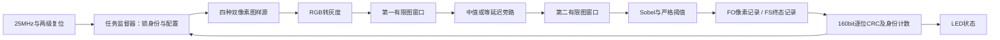

# R1 v1.1 软件验收与中文操作入口

2026-10-05。本批已经完成灰度、中值、Sobel 的独立软件实现、必要仿真、Ti60F225/I3 综合、接口生成、布局布线、时序审阅和实际 bit/hex 生成、staging 登记。软件状态为 `DONE_STOP_AFTER_BIT`。这是 R1 批次的交付，完整五项基础、六项高阶仍有后续工作。

授权为 `AP-ALGORITHM-R1-20261004-v1.1`，设计 R1 v1.1 继承完整 R1 v1 A/H，基线 `ALGO-BL-20261004-v1.1` 共 22 份。批准及本地审计例外见[用户原始批准](../03_review/approval-r1-v1.1.md)。生产参数保持 1920×1080；当前独立四引脚工程真实时钟为 25 MHz。

## 1. 先整体，再接口、局部及交接

每组两个像素；输入、窗口、输出和记录均以 `valid && ready` 的真实交接前进。两次窗口各自复制有限图边界；第二次读取已经中值处理的图。任务握手锁定配置，流水过程中外部配置变化不改变当前任务。取消、坏输入和复位的实际前缀、内部清空及后续恢复均有独立测试。

建议按下面次序阅读，先对照设计草图，再进入相应源码与证据：

| 次序 | 文档/文件 | 阅读目的 |
|---|---|---|
| 1 | [R1 v1.1 修订卡](../../../planning/design-TRACK4-ALGORITHM-R1-001-v1.1.md) → [完整 R1 v1](../../../planning/design-TRACK4-ALGORITHM-R1-001.md) → [FE 设计](../../../planning/design-TRACK4-FRONTEND-001.md) | 先整体 B/C，再 D 接口、E 中文草图、F/G/H 验证与追踪 |
| 2 | [整体操作与双向追踪](../../../work/active/track4_algorithms_20261004/r1/docs/r1-operation-and-traceability.md) → [顶层](../../../work/active/track4_algorithms_20261004/r1/rtl/r1/r1_algorithm_top.sv) | 四端口、监督器、像素源、FE、观察器的实际接线 |
| 3 | [窗口与整帧实现](../../../work/active/track4_algorithms_20261004/r1/docs/window-frame-implementation.md) → [算术实现](../../../work/active/track4_algorithms_20261004/r1/docs/arithmetic-implementation.md) | RAM 延迟写、跨行、底行重放、尾部；灰度/中值/Sobel 位宽与逐级延迟 |
| 4 | [独立参考说明](../../../work/active/track4_algorithms_20261004/r1/docs/reference-implementation.md) → [FE 验证](../../../work/active/track4_algorithms_20261004/r1/docs/frontend-verification.md) → [外壳验证](../../../work/active/track4_algorithms_20261004/r1/docs/r1-verification.md) | 黄金与 RTL 分离，逐像素、协议、记录及 CRC 的真实判据 |
| 5 | [Efinity 中文操作](../../../work/active/track4_algorithms_20261004/r1/docs/efinity-operation.md) → 下方物理报告及产物 | 先工程/约束，再资源、pin、STA、bit 来源 |
| 6 | [Root 独立读回实录](../03_review/r1-independent-implementation-review-v1.1.md) | 查实际阅读范围、失败保留、修复与最终证据 |

当前独立 work 保存 12 份 RTL：六个前端模块及六个监督/图样/记录/LED/复位/顶层模块；两个独立 Python 参考；五个 FE 测试入口及共同 driver、三个外壳 TB；三份主运行脚本、工程 XML/peri/SDC。诊断补验另有独立记录。原 HDK、参考工程及原厂 RAM 模型保持只读。

## 2. 实际仿真结果

| 证据 | 本次真实结果 |
|---|---|
| [FE 完整 006](../../../work/active/track4_algorithms_20261004/r1/sim/frontend/runs/frontend_suite_006/suite-result.json) | `PASS`，123/123 场景，FT-01…11 全覆盖；126 次子工具调用均正常退出；数值/协议错误均 0 |
| 四个完整 1920×1080 job | 每项接纳、交付、比较 1,036,800 组双像素，合计 8,294,400 像素；四种 median/kind 组合及不同图样/阈值；正常终态、内部全空 |
| [FE 黄金清单](../../../work/active/track4_algorithms_20261004/r1/sim/frontend/runs/frontend_suite_006/vectors/manifest.json) | 306 份文件、8,322,536 行 hex 经路径/位宽/行数/SHA 审核；模型直接计算二维邻域，不从 RTL 获取期望 |
| [R1 外壳 005](../../../work/active/track4_algorithms_20261004/r1/sim/r1/runs/r1_shell_005/run-result.json) | `COMPLETE`；4×3、8×5 各 69 job、64 种配置；四种 258×258 图样各比较 33,282 组；八个 typed 场景及逐记录 CRC 通过 |
| 失败处理探针 | 三个故意 fatal 均真实退出 3，且没有成功 JSON；不能仅搜索 PASS 字符串或使用进程退出 0 推定通过 |
| [真实 WLF 读回](../../../work/active/track4_algorithms_20261004/r1/sim/frontend/observations/wlf_readback_001/readback.md) | 气泡、跨行、背压、底行重放、窗口 B 尾部取消/reset/恢复的实际信号采样；查询未改原 WLF |
| [T=41 双补边补验](../../../work/active/track4_algorithms_20261004/r1/sim/frontend/runs/border_discriminator_002/readback/corner-readback.json) | 4×3 ramp 的四角：旁路 L1=44/edge=1，中值 L1=40/edge=0；独立黄金、真实整核输出与 WLF 一致 |

四个生产 job 在无停顿整核测试中各用 1,038,747 拍。外壳 CRC 观察器每条记录逐位处理，主动反压，因此这份四 pin bit 的运行速率不用于证明 HDMI 60 Hz 或相机吞吐；100 MHz 仿真驱动也不等同于 100 MHz 物理时序通过。

早期失败全部保留：许可继承、路径审计、FE005 的无 FS 单元状态元数据、Interface 空 registry、SR 名称匹配、SDC 加载时机及首次 Bit 空跑。FE005 数值通过但汇总失败，只修状态 NA 元数据后新完整 006 验证；旧 run 不回写 PASS。

## 3. 综合、引脚、布局布线与时序

最终物理 run 为 `r1_physical_005`，Map/Interface/Pnr 均真实退出 0、未超时；Root 读取主 STA、PT/引脚、packed 资源及独立布线后覆盖报告。17 份实现/模型/工程文件与冻结副本一致。

| 项目 | 实际值 |
|---|---|
| 芯片/速度档/时钟 | Titanium Ti60F225 / I3 / 25 MHz，40 ns |
| Packed 资源 | 3411/60800 XLR，8/256 RAM10，0/160 DSP；1 GBUF |
| 综合计数 | LUT4 1886，FF 2305，ADD 575，SRL8 78；与 packed XLR 分开解释 |
| Setup / hold 最差余量 | 35.381 ns / 0.063 ns |
| 内部时序覆盖 | no_clock=0，unconstrained_internal_endpoints=0，multiple_clock=0 |
| 复位 | KEY 只例外到两个各匹配一次的异步 SR；一级 Q→二级 D、二级→core/RAM 仍计时 |

| 端口 | 球号/电气 | 用途 |
|---|---|---|
| clk_25m | J2，1A/1.8V，GCLK | 板卡 25 MHz 输入 |
| key1_n | P13，BR/3.3V，pull none | 板外上拉、低有效复位 |
| led0 | N14，BR/3.3V，drive 4 | 最后任务身份/计数完整 OK |
| led1 | P14，BR/3.3V，drive 4 | 最后完整记录 CRC 轮读 |

[物理审阅汇总](../../../work/active/track4_algorithms_20261004/r1/runs/r1_physical_005/physical-audit.json)为生成 bit 前的不可改记录；完整报告路径及 SHA 在其中。综合 42 条警告和 Questa `+acc` 优化提示均保留，不能称所有工具零告警。原厂 `write_sdc` 导出缺换行，只作展示；有效输入是已成功解析的冻结 [SDC](../../../work/active/track4_algorithms_20261004/r1/project/r1_algorithm.sdc)。

## 4. 实际 bit/hex 与来源

[staging 产物清单](../../../artifacts/staging/ALGORITHM-R1-20261005-v1.1/artifact-manifest.json)保存原输出路径、大小、SHA、批准、基线、构建 run、各项证据及停止位置。原 Efinity outflow 保留；本次没有晋升 validated/canonical。

| 产物 | 文件字节数 | SHA256 |
|---|---:|---|
| [r1_algorithm.bit](../../../artifacts/staging/ALGORITHM-R1-20261005-v1.1/r1_algorithm.bit) | 1,731,456 | `F55F973B54355A70B65F914448F8A6E6E4431C672312DF954D3042B0DCFFB321` |
| [r1_algorithm.hex](../../../artifacts/staging/ALGORITHM-R1-20261005-v1.1/r1_algorithm.hex) | 1,731,516 | `06907FBFCD7824AA387A3A84914F46603483FD6202E18B793A004420EDF560AD` |

实际生成来自同 run 已布线的 480,729 字节 `.lbf`，SHA `22DE3B96DDAD6C2A3C6FDA82F418A83AE1F00E1A520E729161004F69DF134428`，并核同 run `.lpf`。第一次工具退出 0 但跳过生成，登记 `FAIL_NO_ARTIFACT`；修复明确 source/dest 后，独立 `bitgen_retry_001` 真正生成两文件，实际日志/来源与产物见[重试证明](../../../work/active/track4_algorithms_20261004/r1/runs/r1_physical_005/bit-attempts/bitgen_retry_001/bit-generation-proof.json)。首次记录、release gate、冻结源码与原物理审阅不改。

Root 另完整检查当前两文件格式：均每行两个 ASCII 十六进制字符加 LF，分别 577,152 和 577,172 行，非法项 0。表中大小为磁盘文件字节数；该格式检查不代替实体配置验收。原 PNR 主 log 在隔离审阅副本保留原 hash；后来 pgm 改写主 log，成功 pgm 全文另存该重试 `tool-pgm.log`。首次空跑主 log 的原始字节没有另存副本，其当时消息/hash 和首次阶段四记录保留，未称原始字节仍可读。

## 5. 中文人工观察步骤

1. 从第 1 节顺序读设计与实现说明，先能指出 FJ/FP/FO/FS 各自 owner、真实握手、配置锁定和取消边界，再看局部 RTL；任务 ID、设计接口、稳定符号与测试在整体追踪表双向关联。
2. 用 Efinity `File/Open Project` 打开 [r1_algorithm.xml](../../../work/active/track4_algorithms_20261004/r1/project/r1_algorithm.xml)，核顶部型号 Ti60F225/I3、顶层 r1_algorithm_top、1920×1080 默认参数及十二份源码；仿真原厂 RAM 模型不加入综合清单。
3. 阅读已有 `r1_physical_005` 的 Map/PT/Pnr/STA 报告，核四球号、电压、40 ns、最差 setup/hold 和两级复位例外。现有结果不必为查看而重跑，不覆盖已存在 run/attempt。
4. 在 Questa 打开前端操作说明所列小图 `trace.wlf`，并排看 clk、valid/ready、坐标/index、阶段及 RAM 地址/使能。气泡不前进；背压保持输出；重放首拍可提交末 REAL 的 pending 写；取消/reset 后结合 all_empty 和恢复 job 看实际历史清除。直接对照已保存采样表。
5. 看参考/TB 每组比较、typed 错误、真实 fatal 退出与完整 1080p 计数，再查看 release gate 及 staging 清单中来源/SHA。人能读懂的证据、Agent 读回与真实硬件现象分别登记。

本次止于 bit 生成和登记，没有调用 program、烧写 Flash、调试器或实体观察，也不请求这类动作。PostgreSQL 未配置，使用用户已批准的本地事件与 side-effects；正式 PROJECT_STATE、TASK_LEDGER 和硬件节点保持原 hash。用户人工理解验收、实体硬件验收均未代签。

## 6. 后续五类工作

| 类别 | 已继续形成的设计 | 尚未完成的闭合/实现 |
|---|---|---|
| 实际存储与通信 | 板载 DDR3、45 对象地址/目录、源寿命、pin/holder 及 RAM 候选 | 完整实际 backend、LOAD/GRAD 生命周期、权限更新/返回、仲裁及服务保证 |
| 性能与资源 | R1 实测；生产窗口/ROW、共享控制 RAM、识别工作集与预算候选 | 全机完整 RAM/FF/DSP 账、最坏服务/帧处理时间、生产时钟真实 STA |
| 生产输入输出 | 摄像来源、采集 ring、提前 SCAN、行预取、HDMI/重放及 CDC 候选 | 摄像头/DDR/HDMI 真正统一接线、完整 pin/SDC/缓冲和错误恢复 |
| 整包整合 | 整合 v0.8、局部中文草图、接口/追踪及独立审阅；本批文件管理已交付 | 全部接口冻结、共同文件/基线/独立参考与完整十一项测试计划 |
| 后续实现与验证 | R1 批次完成并停在 bit 后 | 完整 Canny、闭包、圆/旋转矩形及生产链；对应 READY_FOR_REVIEW 设计获批后生成代码并执行整包验证 |

后续设计入口为[整合主稿](../../../planning/design-TRACK4-ALGORITHM-INTEGRATION-001.md)。R1 单批批准不扩张后续源码范围，完整十一項目前仍 `NOT_READY/NOT_APPROVED/NOT_IMPLEMENTED`；总体目标继续推进。
