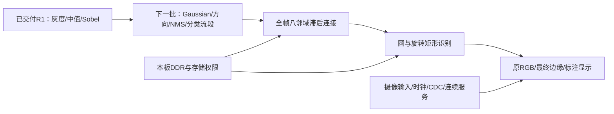

# 完整软件试验的继续推进与阅读路线 v0.1

2026-10-05。本页另存后续进度，R1 的验收报告、原五个交付入口、批准基线与比特流保持原版本。完整五项基础、六项高阶仍未全部实现。当前后续工作是设计与审阅；没有用 R1 批准生成范围外源码或测试。

先看已有结果：[R1 中文软件验收报告](r1-software-acceptance-v1.1.md)。灰度、中值、Sobel 已有真实代码与独立参考；123/123 测试通过，四张完整 1920×1080 图合计比较 8,294,400 像素，数值与协议错误为零。Ti60F225/I3 四引脚 25MHz 工程已综合、布局布线和时序检查，使用3411 packed XLR、8 RAM10、0 DSP；真实 BIT/HEX 已登记 staging，按要求停止硬件步骤。这是该独立工程的结果。

## 1. 十一项目前的位置

编号沿项目赛题需求；软件结果与实物结果分开。当前所有实物观察仍未执行。

| 项目 | 软件完成范围 | 尚需完成 |
|---|---|---|
| B1 摄像头输入 | SC431HAI/CSI、DDR参考来源和部分IP编译/综合证据已有 | 完整生产输入接线、模式、CDC、缓存与功能验证；参考保护源码缺解密key的Questa编译失败保留，未展开 |
| B2 灰度 | R1算法、独立参考、完整1080p验证及物理工程通过 | 连接生产摄像头和显示 |
| B3 Sobel | R1算法、独立参考、完整1080p验证及物理工程通过 | 生产配置、帧存储与显示交接 |
| B4 HDMI | 已有显示、行预取/渲染、采用/退休设计 | 完整1080p60生产工程、连续行服务与时序验证 |
| B5 完整交付 | R1源码、约束、测试与中文操作记录已交付 | 十一项统一整包、最终比特流；实物演示视频待硬件 |
| A1 中值 | R1算法、独立参考、完整1080p验证及物理工程通过 | 生产配置与整包交接 |
| A2 实时阈值 | 配置/按键、原子帧配置及显示合同已设计 | RTL、独立验证和生产接线 |
| A3 DDR帧缓存 | 已确认本板DDR3控制器、PHY和软件工程来源；存在有限IP实测 | 新算法真实后端、仲裁、初始化/封存/关闭、连续服务与完整工程 |
| A4 完整Canny | Gaussian、新梯度/方向、NMS/分类、精确八邻域滞后连接已有局部设计 | 流段与全帧连接的实际代码、独立测试及整包物理验证；分类图不能当最终边缘 |
| A5 彩色叠加 | 原RGB、最终边缘、标注的同帧重放与行渲染已设计 | 完整实现、逐像素对齐与连续显示验证 |
| A6 圆/旋转矩形 | 数值、识别、存储、独立GT质量合同和24类288场景配方已设计、审读 | 完整schema/PROFILE、代码、实际P/R及资源/时间证据 |

## 2. 从整体到局部的阅读顺序

1. 整体目标、生产路径与尚未闭合的组合边界：[INTEGRATION v0.8](../../../planning/design-TRACK4-ALGORITHM-INTEGRATION-001.md)。该文件保留写入时的历史状态；R1现状以上述实际验收报告为准。
2. 算法局部顺序：[R2流段](../../../planning/design-TRACK4-ALGORITHM-R2-001.md) → [C0中文事件草图](../02_design/canny-stream-controller-sketches-v0.1.md) / [OBS观察工程草图](../02_design/canny-observer-project-sketches-v0.1.md) → [八邻域连接](../../../planning/design-TRACK4-ALGORITHM-R4-CLOSURE-001.md) → [识别](../../../planning/design-TRACK4-ALGORITHM-R4-RECOGNITION-001.md)。旧“未实现”描述不改写为后来的证据。
3. 局部之间的真实交接：[LOAD/GRAD三分支](../../../planning/design-TRACK4-ALGORITHM-LOAD-GRAD-001.md) → [阶段权限](../../../planning/design-TRACK4-ALGORITHM-STAGE-CAPABILITY-001.md) → [联合读回记录](../03_review/load-stage-joint-review-v0.1.md)。先准备再启动；SRC、CLASS、GRAD分别关闭；真实返回先于依赖它的关闭回执；GRAD封存后才授识别只读资格。
4. 局部内部细节：[冷权限RAM](../../../planning/design-TRACK4-ALGORITHM-STAGE-CACHE-RAM-001.md) 的字段→15词读回→检查→回复，以及 [ROW上下文引用](../../../planning/design-TRACK4-ALGORITHM-METADATA-TRANSPORT-001.md) 的双镜像写入→COMMIT→跨域消息→目的读回→业务关闭→metadata退休。两项均为未采用候选。
5. 存储/时间/质量：[DDR服务预算](../../../planning/design-TRACK4-ALGORITHM-DDR-SERVICE-BUDGET-001.md)、[资源缺口审查](../03_review/production-resource-gap-review-v0.1.md)、[H1布局候选](../../../planning/design-TRACK4-ALGORITHM-HIST-PLACEMENT-001.md)、[独立质量合同](../../../planning/design-TRACK4-ALGORITHM-QUALITY-CORPUS-001.md) 与 [QC/H1审阅](../03_review/quality-and-hist-contract-review-v0.1.md)。预算、设计读回、未来测试与实际工具通过分别记录。
6. 新的具体附件：[EXEC长READ许可](../../../planning/design-TRACK4-ALGORITHM-EXEC-BULK-CAPABILITY-001.md) → [24类质量配方](../../../planning/design-TRACK4-ALGORITHM-QUALITY-RECIPES-001.md) → [配方独立审阅](../03_review/quality-recipes-independent-review-v0.1.md)。它们提供局部操作和明确测试参数；当前尚未采用或实现。

## 3. 本轮已经形成的具体设计进展

三分支交接明确了生产SRC逐组读取、CLASS写入、完整GRAD写入及独立关闭。CS是流段的实际终态，不能代替完整存储token。CLASS关闭不会提前释放SRC或GRAD；GRAD写者实际返回后，父存储owner依据真实完整写入记录提交不可变对象，随后识别才能读取。

资源审查提出两个有限候选并补齐代价。权限快照存一块20×512 RAM，默认32行、每行15词，保留完整295bit和高5bit零检查；同一已列口径从15845热状态位改为6780 selected bits，但查询最早响应21拍、相邻接纳23拍，原4拍不能继续使用。显示行四类消息改引用完整冷上下文，需要两个真实域的RAM镜像、独立源/目的槽和关闭控制；条件容器算式63191−11508+6345=58028位。这些不是实测FF或整机fit，也不能把不同部分账直接相加。

可选全半径H1票表修正了旧候选与camera ring重叠的问题：从原AUX未分配尾放入524288字节及64字节guard，五ring和旧对象不移动，128MiB生产arena包络仍124.25MiB。新对象、权限、缓存容量和服务仍需共同版本；旧H0数学及旧布局没有自动替换。

独立质量合同统一使用原算法的整数像素中心，GT在识别前依据原场景形成，不能从DUT候选拟合。开发集与验收集分别统计，规定主门只计将来预先冻结的192个ACCEPT场景；真实失败仍计FN。任意旋转、重叠、负样本、整条边缺失和尺寸/噪声边界继续纳入测试设计，未恢复96–768像素、最多4目标或对比64等硬准入限制。具体图像与GT尚未生成，95%质量尚无运行结果。

24类具体配方已保存，根代理实际全文读回362行，随后全文读回145行独立审阅。参数静态计得96 DEV有75圆/71矩形，192 ACCEPT有179圆/172矩形；原可观察GT在遮挡、全擦和低对比之前确定。同图异GT的整短边缺失/负U配对、同心目标重数及三份全灰220 ACCEPT继续保留，不能用scene ID查表或删除难例达到指标。未来实际生成还须冻结完整schema/PROFILE、图SHA及真实P/R，当前这些计数和整数证明不是识别PASS。

EXEC只读长许可候选已完整读回299行：用独立length12/end33合同覆盖16…2048B、真实4KiB分段及单permit关闭。四份完整冷上下文新增1RAM，最早普通回复6拍；13808 selected bits和旧87词每burst的比较均为条件设计账。它保留原pin、旧published请求和RETURN→关闭回执→metadata退休次序，具体真实来源/服务仍OPEN，不据此宣称生产显示已满足期限。

## 4. 接下来怎样推进

下一批[R2流段实施设计v1](../../../planning/design-TRACK4-ALGORITHM-R2-STREAM-IMPLEMENTATION-001.md)已完成有限独立[设计评审](../03_review/r2-stream-implementation-review-v0.1.md)和Root分段全文读回，状态READY_FOR_REVIEW/未批准。仍用1920×1080，复用R1已验证源码，新增Gaussian、方向、fork、NMS/分类、C0及完整观察工程；31个新文件、20物理SV、230必需仿真加15校验/失败探针、真实生产sourcefault与无reset恢复、40ns四pin工程均已具体规定。[新基线ALGO-R2-STREAM-BL-20261005-v1](../01_baseline/algorithm-r2-stream-baseline-v1.json)冻结48输入，实际48/48大小/哈希一致。已修正向量合计414B/pair，保留原6GB/另10GB空间预算；沿前终态候选由K同fire检查共存并锁定。当前等待这份具体版本、范围、基线和本次独立软件本地审计例外的一次批准，未生成R2代码或运行新测试。

整机剩余五类工作对应如下：实际DDR存储/通信仍缺完整provider和权限/关闭矩阵；性能资源仍缺唯一实例全账与真实有限服务；生产IO仍缺确定时钟/模式/CDC及首行和连续行期限；整包仍缺共同schema、PROFILE、完整文件基线及追踪复审；后续实施与验证待相应成熟版本批准。所有这些设计以现有板卡资源和已允许的DDR3为边界，不降低原图像分辨率或私自新增算法fps门槛。

除上述已READY的R2成熟流段外，其余整机后续卡仍NOT_READY/未批准/未实现。审批前完成可审阅设计、预算与验证计划；实际新增代码、可执行参考/测试、工具运行在指定批准后执行。正式数据库、PROJECT_STATE、TASK_LEDGER、硬件状态未改变；没有下载或实物编程。

## 5. R2待批期间补齐的后续证据

本轮独立审阅和Root读回补出三个具体交接，实施仍未运行：

| 后续部分 | 本轮实际设计进展 | 下一项尚需闭合 |
|---|---|---|
| 完整八邻域Canny | [闭包实施缺口审阅](../03_review/canny-closure-implementation-gap-review-v0.1.md)已全文读回174行。QUEUE第1,245,184项的真实地址是0x04000000，旧26bit会截成0；完整1080p必须用32bit原始地址桥。给出单S、两16B claim postimage、完整队列及CLASS初态→独占CLO→EDGE阶段token→真实RETURN→O不可变发布的具体候选 | 将一个真实后端/目录交接实体的字段、沿表、完整资源和有限验证基线共同冻结；不是已完成的S或完整A4 |
| 显示长读授权 | [EXEC源与fence审阅](../03_review/exec-source-fence-design-review-v0.1.md)已全文读回132行。O唯一writer的真实beforeimage求影响mask，旧FETCH在source首次发布时登记revision；关闭新发布后保旧held履约，permit物理关闭、RETURN和metadata退休按真实依赖推进 | 来源连续保护、具体owner接线、physical-close、完整资源/最坏服务和warm恢复继续OPEN；20新selected bit不等完整FF预算 |
| 生产输入/时钟 | [来源差异审阅](../03_review/production-selected-source-delta-review-v0.1.md)已读回；[PIO v0.3](../../../planning/design-TRACK4-ALGORITHM-PRODUCTION-IO-001.md)保存v0.2精确快照后补A3/D4/中文步骤/验证追踪。选定v7实际CSI5.15、164条相机写入及0x3221←0x66；提出保留实际TL0 #0/global core和ASYN1，不迁不可用的DDR #4 | 实际byte/CFA/模式生效、metadata/错误closure、跨PLL/reset/serializer、生产服务与整包资源仍OPEN；生成参数70不当测频，两帧等待不当原子生效证明 |

闭包单S无cache候选的初始化为9,072,000B/567,000个16B写拍，GENERAL数据保守上界17N拍/564,019,200B；这是静态操作账，未含metadata/仲裁/refresh/effect关闭等，不能换算成已测帧率或用慢速降标替代原目标。Root实际整数核验了64MiB地址反例与两项数据算式。独立报告提出的新353bit证书/1013发布/1150回执都是待冻结接口，未冒充旧来源已有实现。

本轮R2 v1/48输入及原R1交付范围保持；没有收到新增实施批准，不增加业务代码或测试结果。后续纯设计增量已保存并可审阅，下一实施动作仍取决于已提交的R2 v1具体批准；不重复申请原R1批准、不将完整目标改成局部验收。

## 6. 审阅结论已进入主设计

上一节三份报告中的算法/通信增量已纳入可定位的主卡修订；本节为2026-10-05后续检查点，保留此前报告和旧版本，不把纯设计写成实际仿真或资源通过。

| 当前阅读入口 | 已纳入主设计的具体内容 | 实施前仍缺 |
|---|---|---|
| [Canny闭包R4C v0.3](../../../planning/design-TRACK4-ALGORITHM-R4-CLOSURE-001.md) | 单S/共享物理桥、32bit地址、两16B postimage、CLASS初态证书、真实RETURN及O不可变EDGE发布；同步需求/接口/中文操作/数值与验证追踪 | 完整后端/原子组资格、353/1013/1150真实运输与存放、逐opcode有限服务、完整实例及确切验证/文件基线；仍NOT_READY/NOT_IMPLEMENTED/NOT_RUN |
| [EXEC长读v0.2](../../../planning/design-TRACK4-ALGORITHM-EXEC-BULK-CAPABILITY-001.md) | 真实O写入口先封新访问；原FETCH在source PUB_COMMIT同沿冻结旧315/revision；STOP不撤旧held；实际permit建立即记债，physical-close→RETURN→loan关闭→metadata退休 | 冷来源/parent/J保护与实际接线、protected DDR关闭、完整资源/服务/时钟及warm恢复五项OPEN；新增20selected bit不等全FF成本 |
| [DDR服务v0.2](../../../planning/design-TRACK4-ALGORITHM-DDR-SERVICE-BUDGET-001.md) | 加入单S完整GENERAL/两快路径physical数据、对象各一次INIT、AXI通道握手与opcode服务式；区分已分配124.25MiB、候选128MiB和名义物理256MiB，保采集/显示/算法各自服务 | 全部服务μ/M/真实效率、native/journal/admin公平、生产schema/唯一资源及逐行期限未闭合；不能用总byte除名义带宽证明帧时间 |

读回中补清两个关键顺序：INIT/CLEAR自身先由exclusive BUILD/INIT写资格接纳，ordinary RMW才依初始化前缀；CLASS在新LOAD BUILD只清一次，CLO承接proof，不能重清已加载分类图。DR713的1…64B/512bit payload只表达最多4个对齐16B拍，该INIT分段是141,750个burst。4,431个128拍burst和17,720个32拍burst仅是另外bulk-INIT接口的几何候选，zero generator、完整expected/握手与WRITE授权仍OPEN，不能塞入旧短接口或借EXEC只读许可写入。

完整GENERAL候选数据上界仍为含INIT573,091,200B；dense全interior fixture为571,844,032B。随机LEN0访问五通道真握手上界37N=76,723,200，不能与17N数据拍或clock混称。显示419.904MB/s为全帧平均，active行尺度437.4MB/s及真实有限bank、逐行deadline另核。所有这些是条件静态设计账，识别/来源/目录/refresh/effects等其它开销尚未全部量化，没有新增处理fps门或缩小图像/识别范围。

R4C/EXEC原版本及DDR v0.1均保存精确字节快照，实际来源/读回/hash进入本地纯文档checkpoint。R1的22输入、五个交付入口/正式三文件与BIT/HEX已重核无变化；R2 v1及48输入再次逐份路径/大小/SHA一致，work/r2尚不存在。当前仍待已提交R2 v1指定批准，不重复索取、不借R1的本地审计例外运行新范围。完整十一项尚未完成，正式DB/硬件节点不变。

## 7. 后端操作与封存记录的具体草图

本检查点继续纯设计，新增两份互相连接的局部主卡；Root已读回原全文及修订，独立审阅提出的顺序问题已写入正文。阅读顺序为R4C整体→下表后端→记录交接→原目录/共享DDR与服务预算；两份均NOT_READY/NOT_IMPLEMENTED/NOT_RUN。

| 新阅读入口 | 已明确的操作与位置 | 实施前仍缺 |
|---|---|---|
| [闭包后端BK v0.1](../../../planning/design-TRACK4-ALGORITHM-CLOSURE-BACKEND-001.md) | 单S的scope安装、每16B完整span授权、CLASS/QUEUE两许可和两journal槽、一次成对提交、每entry状态真实写回、独立FPI关闭/许可END/原typed关闭；32bit地址及INIT的141750请求保留。具名宽body合21606bit，明确保留assembly到状态写回后才换槽，失败reply实际消费后才退组 | O实际许可/来源保护及全机共享接线、完整scalar/唯一实例与有限服务；21606是列出的body并集，不能当完整FF或实测资源 |
| [闭包记录交接CH v0.1](../../../planning/design-TRACK4-ALGORITHM-CLOSURE-HANDOFF-001.md) | 新增一块20×512冷RAM，10种记录占419词，保存CLASS初态353、真实两scope关闭快照938及完整终态/发布回执；逐词写→读回→核验→收据。RETURN结束访问后保历史metadata，LOAD→CLO不等整个CH退休；初态shadow跨scope不清 | 实际encoder/O/S/J联合适配、真实权限与共同隔离/服务资格、整机资源和共同文件/验证基线；15792 selected bits不是新增或完整FF |

源码复核发现旧DDR write master没有BRESP输入、在末W fire后推进，旧read master也没有完整RID/RRESP检查，不能沿用其完成标志证明新算法写入/读响应正确。新后端明确核ID/RESP/LAST/拍数、保在途账和旧held；C2公开wrapper未导出drained/isolation_ack等信号，真实写后可见性、校准/复位隔离及有限服务仍是资格条件。此次没有运行DDR功能仿真、综合或布局布线。

联合读回已区分三种容易混淆的事实：typed请求/回复台账不含INIT，物理FPI台账含INIT；最后seq是序号、cutoff是数量；历史写prefix仍UNKNOWN与未来effects尚未关闭是不同状态。失败后的真实关闭可以解除未来访问债，不能补猜UNKNOWN内容或变为成功。938在RETURN/原502前冻结和复制，CLO安装只等旧LOAD访问及记录借用关闭，不等CH两actor整体退休，避免相互等待。

R1的22输入、原五个交付入口/正式三文件及BIT/HEX、R2的48冻结输入和v1设计再次核对一致，work/r2仍不存在。已有R2指定版本批准请求继续有效；本次只追加文档与本地文档检查点，没有扩大R1实施/审计批准。完整五项基础、六项高阶尚未完成，正式数据库、硬件状态和原HDK均未改动。

## 8. 真实接线、目录开销与DDR验证条件

本检查点继续补齐可实施设计。阅读顺序为R4C整体→BK后端/CH记录→下表联合接线→native成本→DDR资格；三份新卡均为未批准候选，仍NOT_READY/NOT_IMPLEMENTED/NOT_RUN。原BK/CH/DDR服务卡和R2冻结版本没有默改。

| 新阅读入口 | 本轮新增的具体设计或证据 | 实施前仍缺 |
|---|---|---|
| [闭包联合接线CW v0.1](../../../planning/design-TRACK4-ALGORITHM-CLOSURE-WIRING-001.md) | 选择SC逐词登记作为唯一O入口，明确J内部完成记录适配；原BIND只建一次pin，839/847安装后完成实际INIT，O真实写读核descriptor前缀再回END；O原OPEN457分别交J/S，INITIAL490仅由S encoder产生。O完整native job保留assembly，不能每32issue覆写半份记录 | 真实物理关闭资格、全部子借用/控制位/唯一实例及共享服务、共同实现/验证基线。列出的42677bit仅为具名selected并集候选，不能当完整FF或适配通过 |
| [目录/journal成本NS v0.1](../../../planning/design-TRACK4-ALGORITHM-CLOSURE-NATIVE-SERVICE-001.md) | 补入full AUTH/M1/journal/INIT数量，区分事务、native issue、AXI fire与时钟。完整GENERAL密集fixture含INIT有2538659284次AUTH native readissue；当前单S、单M1读口与相串journal阶段的条件下界为1042182540个core间隔。另列两快路径及其queue_ref0前提 | 真实服务有限上界、实际并行与保身份/初始化/取消/退休的优化，以及完整识别和生产竞争；不能只优化DDR burst就宣称当前方案性能最佳 |
| [DDR软件资格DQ v0.1](../../../planning/design-TRACK4-ALGORITHM-DDR-QUALIFICATION-001.md) | 分开旧编译证据与独立elaboration、2Gb模型/PHY、真实响应/可见性、复位与旧效果关闭的未来验证。现装Micron模型固定4Gb/x16；2Gb分支仍缺2048Mb参数头，官方示例若干依赖路径也未闭合 | 匹配原板器件的实际参数输入、合法工具/模型依赖、校准/响应/隔离实证和有限服务。资料存在不能写成DDR功能已验证 |

NS的100MHz换算只说明当前架构下界的尺度：GENERAL密集fixture至少10.4218254秒，两种queue_ref0快路径至少2.037555/2.493747秒；尚无本范围STA，也未计入全部等待。这些不是实测帧时间、成功上界或新增fps门槛。它揭示需要减少重复授权/metadata工作，并不证明完整算法不能在FPGA实现。1080p、完整八邻域Canny、原识别质量、显示1080p60及现有板卡资源边界均保持。

重新读回旧C2日志可确认：公开DDR顶层及其列出的源模块进入vlog，15个真实Efinity原语模型编译日志为0错误；整包的3个错误在CSI加密输入。不能将它改写成DDR编译失败，也不能由此推断独立DDR vopt/vsim或读写/校准已经通过。原示例checker未连接BRESP、使用不同几何/时钟，原axi_ram测试也不能代替匹配器件与PHY验证。

Root实际读回新卡，独立定向审阅已修正NS的读/写分支与物理效果→stateWE顺序；CW补齐前缀更新首次32RE、分开LOAD/CLO启动门、明确SC→LG错误码转换及160bit holder字段。DQ依据公开端口注释确认DRAM_WIDTH=8是每个DQS的DQ数，DQ16/DQS2=8，不能误当器件由x16变x8；匹配2Gb模型/时序/PHY缺口仍保留。静态数量与未知上界分别记录。重新核对R1的22份和R2的48份冻结输入，以及10个原交付/正式文件与BIT/HEX，均无变化。R2现有指定版本批准仍待回复；没有新增业务代码、测试/EDA、比特流、数据库或硬件动作。完整十一项仍未交付完成。

## 9. 三行稳定权限快照与剩余工作量

本检查点针对§8发现的重复目录读取形成了[PS局部设计v0.1](../../../planning/design-TRACK4-ALGORITHM-CLOSURE-PERMISSION-SNAPSHOT-001.md)及[独立费用读回](../03_review/closure-permission-snapshot-cost-review-v0.1.md)。阅读顺序仍是R4C整体→BK/CW联合交接→PS B/C整体职责→D字段与局部接口→E中文操作沿→F资源/服务→G/H验证追踪→I缺口；两份新文档均未批准、未实现、未运行。

PS选择由唯一O保存最多三份稳定资格和几何：LOAD只CLASS，CLO为CLASS/QUEUE/EDGE，真实无QUEUE的两快路径为两份。每份含完整borrow身份与rounded容量，共用完整H/generation/epoch/role/JID，INIT满prefix真实核验之后独立建立，普通请求仍核完整599/674/676/684、S当前操作、最新值、tail、phase和两许可原子提交。它只替换逐次冷全文读取，不删原算法步骤。

新设计明确保存上游已经published但S未接纳的全324，以及S已接纳但尚未形成599的全324；联合fence先计旧fire，撤新访问后继续履约这些旧请求。第一/第二CLAIM许可与原599/两674合并，每span最多一次。成功ACK只确认两份旧集合已锁定，真实effects/permit/borrow关闭另证明，避免相互等待；进行中ACK消费只释放运输槽，保留proof/expected，两个pending真清后才能发同echo终结ACK。审阅中发现C0已held CLASS125、L已接125但未形成324以及CLO生成状态还可能产生旧后缀，因此这些真实source终结路径已具名保持OPEN；新增324快照不能替它们作停止证明。

静态字段核算为snapshot body1588bit，新增桥及选定控制合计5926bit，与CW选定位置合计48603bit；这是局部费用下界，尚非整机FF/RAM/DSP或fit。独立建立读取为GENERAL另增378RE（其中holder122），两queue_ref0快路径为292/100。普通cold读取虽减少，INIT及相串journal仍在：较弱条件工作量下界为369713572/122885100个interval；再保CW串行prefix条件时为383321572/124051500。§8含ordinary cold的旧NS下界不适用于这个替换候选。这些数字不是实测速度、完成上界或新增算法帧率门槛。

仍须先闭合真实DDR效果/可见性/复位资格、125及未324源终结与S/O动态接线、唯一整机实例资源及服务上界，再共同冻结实现基线。Root已全文及修订读回PS和费用报告；作者及两位独立读者复核字段/数量和旧请求语义。R1的22份、R2的48份冻结输入及原10个正式/交付/BIT/HEX guard再次全部一致，R2 work仍不存在；现有R2 v1指定批准问题保持待答，不重复索取，不扩大R1的实施/审计例外。完整五基础/六高阶尚未软件交付完成；本次没有新的业务代码、仿真、综合、布局布线、比特流或硬件动作。

## 10. 分类源终结与存储返回的有限交接

本检查点新增[源债关闭SQ v0.1](../../../planning/design-TRACK4-ALGORITHM-CLOSURE-SOURCE-QUIESCENCE-001.md)，按整体行为→唯一owner→原完整接口→生成边界→中文操作沿→资源/验证追踪的顺序读。保持完整1080p/Canny与原识别要求；R2/C0冻结公共口及PS/BK等旧卡字节未改。新卡NOT_READY/NOT_APPROVED/NOT_IMPLEMENTED/NOT_RUN。

实际来源澄清了一条可以复用的合同：真正取消C0后，原ABORT/data_flush允许作废尚未交付的私有CLASS125；L已接纳的125保真实raw/good前缀，尚未形成STORE324的后缀可合法失败处分，已经held的324、S已接纳但尚未599的324及已有许可/物理effects仍按原真实账收尾。取消或fence沿先记旧fire，并在新的324形成点优先阻止发布，不能只看沿前valid0再遗漏同沿产生的新请求。已有heldCJ先兑现，J记录真实CJ接纳后持续取消，不窥C0私有phase或伪造未启动。

源终结采用J唯一实际保存的完整CS592、原CLASS_SEAL863及L/C真正关闭的生成门；source-data-quiet不等待LC/CL终态、502或父退休，避免与RETURN互等。C0已经形成reason0 CS后L再失败，保原CS全文；它可证明源结束，却不证明存储成功。CLO只关闭自己的生成器，不等待不存在的新C0终态。原permit/native/JNL/DDR效果关闭另证，源quiet不能代pin返还。

独立审阅发现并已修正DEFER的组合边界：额外冲突静态变更依实际受影响对象/身份的全部相关使用及来源借用寿命等待；不能仅由LOAD RETURN变更仍被353/CH/LG/CLO保护的字段，也不能挡同一任务的合法LOAD→CLO再等CLO释放借用。当前任务沿原身份交接及必需commit/PUB继续，封的是替换任务/generation或使用变后资格的新准入。六个新具名位的初始化/置位/保护寿命、BUILD引用名称及S accepted-before-AUTH取消场景均已补齐并定向读回。

选定增量仅6bit，与PS选定增量合5932bit、与CW选定位置合48609bit；未把原CS/seal/cancel/STORE/term各端存放免费去重，也未称完整FF/RAM/DSP或fit。仍缺SQ-B01实际受保护内部view、完整owner/借用及生成点接线、SQ-B02真实物理资格与整机资源/服务/共同基线。Root全文及修订读回，三位独立读者完成有限审阅；这证明局部合同可以审阅，不是执行或整包成功。

R1的22份、R2的48份输入与原10个正式/交付/BIT/HEX guard再次核验一致，原PS hash也保持；R2 work不存在，既有R2 v1指定批准问题仍待答。正确数据库环境键FPGA_AGENT_DATABASE_URL仍未配置，正式数据库、Manifest、状态、原资料和硬件节点不改。此次仅新设计/进度文档及纯文档检查点，无新增业务RTL、可执行测试、仿真/综合/布局布线/时序/比特流运行；完整十一项仍未完成。

## 11. 源体存放、唯一目录核验与保留寿命

新增[源体实际存放SV v0.1](../../../planning/design-TRACK4-ALGORITHM-CLOSURE-SOURCE-VIEW-001.md)，按整体行为→owner→资格排队→M1实际地址→原源体view→保留与关闭→中文沿→费用/验证追踪阅读。原SQ/CH/CW/PS和冻结R2不改，SV仍NOT_READY/NOT_APPROVED/NOT_IMPLEMENTED/NOT_RUN。

独立审阅确认正常CS已有CH0的107…136词存放，且记录收据可先于S_FINAL/RETURN；但取消后的failedCS存档资格未全定，合法no-start本来没有CS记录。因而本轮选择统一从原受保护M1读取fullLG1119（282…337，56词）或CLJ438（338…359，22词）到唯一已计O2257，再核原J真CS/no-start、L原seal及生成处分、C原生成门。CH CS历史保原用途，不以缺记录猜无CS，也不为CLO索取不存在的CS。真实pending等材料时不占CH受理、assembly或native；INITIAL353/490和必要op5继续。

S_FINAL938及其BEGIN只能在匹配当前scope的旧源核验结果和真实effects quiet均成立后形成，随后才真实record收据→RETURN→502→term。换CLO先撤当前LOAD资格，再按新完整身份核验，旧CH8历史保留；非法早held938仍履约旧运输，但不能占唯一槽等source未来变好来追认。这个顺序排除了用938/term/RETURN反证源quiet的回环。

新增三个J/L/C源历史保留位，保护LC/CJ/已锁CS、L的LC/已消费seal863以及C独立CLJ直到真实metadata退休，原valid消费不擦历史。Root读回修正了CLASS125工作槽边界：它仍逐pair正常复用，保护位不能封死整帧。真正未结pending/query/native借用及未来形成点必须先关闭；O自持的保留位不要求先清零才形成IF05 ACK，两个正确ACK及旧债空后才退保护，避免退休等自己。没有CH也不能免除已经S绑定的938/RETURN债。

父LC270、L的270/125/863、C目的438补列1966bit；保留3、pending/selector/phase、issued/captured/readpending与全dispatcher编码补列25bit，合计新增具名1991、selected并集50600bit。这仍是部分真实位置的设计账，尚非完整FF/XLR/RAM/DSP或fit。正常两scope核验共78个nativeRE；首实际RE为基准的条件最早interval分别59/25，不是端到端成功上界或帧率。

协议读者还发现一项需要写明的来源核验：L的863中CS592必须与J真实接纳缓存逐bit相等，不能只有同CJ/各自规范就接受；相同CJ下计数、FS或诊断不同也拒资格。Root已在D3及T02补全这项比较，费用不变。Root新卡全文及修订行读回，三位独立读者分别核语义、协议组合和数值/复用，修订另定向核验；链接/来源hash静态核验及R1的22份、R2的48份、10个正式/交付/BIT/HEX guard一致，SQ/CH/CW/PS及冻结R2 hash保持，R2 work不存在。仍需真实owner/绑定/形成点/dispatcher接线和完整预算、DDR物理资格、生产输入输出及整包实施基线。数据库/正式状态/硬件未改，本轮没有新增业务源码、运行测试、EDA或比特流；完整十一项尚未软件交付。

## 12. 独立DDR展开输入冻结及整机资源边界

本轮将[DDR Q0 v1短卡](../../../planning/design-TRACK4-DDR-Q0-001.md)收敛到READY_FOR_REVIEW／NOT_APPROVED／NOT_RUN，冻结[DDR-Q0-BL-20261005-v1](../01_baseline/ddr-q0-baseline-v1.json)：30源码/头+安装INI1、工具入口4、上下文9，共44条全部身份相符。独立新work尚未创建。阅读顺序为范围/输入→有限判定→库与合法展开接口→中文步骤→语言/工具边界→场景/追踪；仅编译/合法vopt，不含TB/DRAM模型或任何时间推进。缺模型不挡Q0的诊断设计，Q0通过也不证明初始化/真实读写/故障关闭。

两位独立读者发现审批后基线循环和过宽ENV_FAIL，已在呈现前修正：历史治理采用不可变[审批前快照](../01_baseline/ddr-q0-approval-manifest-snapshot-v1.yaml)，live另外核真实指定授权与合法追加；普通设计诊断保实际类别。根全文及修订行读回，两位独立读者全文复核卡/JSON并再次逐44项一致，支持本Q0范围READY。旧整板terminal矩阵、旧DQ/闭包卡/R2不改；旧R1授权不扩成Q0许可。

[本轮资料和资源复核](../03_review/ddr-q0-intake-and-resource-evidence-v0.1.md)明确真实DDR/2Gb几何和五通道都存在，原板说明/MC公开端口/本机generic帮助尚未提供匹配IP的B后可见性或reset/cal_loss no-future保证。资源175+CH0=176只是缺识别工作池的候选小计；DIR仅3040bit分散余词、M0/M1比五RowCtx少116词且未授访问；识别17,526,269B尚未映射。selected50600仍不等FF/XLR或完整fit。完整预算的七类实际存放与生产I/O/服务/共同基线继续OPEN。

报告也记录一次子审阅误输出未选文件部分保护封装的偏差：立即停止，未解密、解释或采用，未选文件不入清单，不重印内容；之后按实际保护标记截断。R1 22、R2 48和10个守护项再次一致，Q0/R2 work不存在，数据库/正式状态/硬件不改。本轮没有新业务代码、运行测试、EDA或比特流；完整五基础/六高阶尚未软件交付。现可呈现Q0指定批准，已有R2指定请求不重复。

## 13. 当前识别记录与既有DDR槽位的打包字典

本轮补齐[识别记录PK v0.1设计卡](../../../planning/design-TRACK4-ALGORITHM-RECOGNITION-OBJECT-PACKING-001.md)及[26对象打包字典](../01_baseline/recognition-packed-record-map-v0.1.json)，沿当前R4完整字段和既有生产槽位解释位→字节→16B单元。阅读按整体→模块→交接→局部中文草图→数值/时序→边界场景/追踪；当前NOT_READY/NOT_APPROVED/NOT_IMPLEMENTED/NOT_RUN。第12节“17.5MB尚未映射”在此澄清：原固定地址已存在，今补逐记录解释，真实硬件访问尚未实现。

字典26类、32实例，D7仅24工作对象（POINT、ANN、一份当前RECORD和21private）；独立复算逻辑17,526,269B、整表round16 17,526,288B、当前round64 17,526,400B。单条记录最多覆盖4个16B单元，FIT_STATS实际16项最多3，VC最多4；HIST658跨4KiB需合法拆分。逐record补字节/128bit槽分别19,100,956/67,380,480B，只作比较，后者超原POINT/ANN槽，未采用。旧26bit地址会截坏POINT基址，必须按实际32bit地址、先容量与33bit末端检查。

[静态审阅报告](../03_review/recognition-object-packing-review-v0.1.md)登记Root初卡全文及最终定向读回、三位独立有限审阅。协议意见已修：仅RECORD COMMIT payload携F，POINT/ANN全零；取消不撤旧held RQ/NUM/RSP，同沿先记旧fire；schema仅REGISTER字段。JSON几何和五来源hash相符，仍不证明最新值、原子组、初始化、权限或真实DDR写完成。

剩余PK-B01权限/初始化及管理桥、PK-B02跨单元/分组journal与partial/UNKNOWN、PK-B03真实DDR可见性/no-future、PK-B04实际FF/RAM/DSP和服务时间。当前工作数据全round64清零1,095,400个16B单元只是保守候选，不含只读输入、历史RECORD或guard，尚未选择或运行。保持1080p及完整十一项范围，不拿容量账作整机fit。

R1 22、R2 48、Q0 44项输入及原10项守护、8份旧闭包/DQ/R2文档再次一致；正式Manifest/状态/任务账、数据库、原资料及硬件未改，R2/Q0 work未创建且无新指定批准。本轮仅文档/静态JSON元数据与本地文档检查点，没有新业务代码、可执行测试、EDA或比特流。完整五基础/六高阶仍未全部软件交付；待答问题不重复，继续先闭合可独立设计部分。

## 14. 识别初始化、单槽串行访问及真实费用

本轮完成[RA访问候选v0.1](../../../planning/design-TRACK4-ALGORITHM-RECOGNITION-ACCESS-001.md)，按整体选择→owner连接→IF→逐单元/逐lane中文草图→状态/费用→场景追踪阅读。选择首次合法阶段全round64数据区16B顺序清零；不能RJ接纳即清24表，POINT构造前预清在E=0时仍照计，而COMMIT管理路径不另造数据访问。阶段SEAL非永久immutable，复用须旧引用闭合和真实新可写资格。

选择单pack sequencer、一leased journal槽逐DENSE lane复用，全组门跨END/退槽持续；580assembly的512字段在收集/patch/prepare不重叠时复用。前lane真实可见及全部引用/permit闭合后才能退槽/重新读最新；单B不足，未选免费forwardcache。RC自有RQ799/RSP872/assembly580和具名控制合2352bit只是部分热账；旧shared journal1RAM/176bit账不扣，pool租约仍拟议，transport/完整失败/seq等待收费。

[有限静态审阅报告](../03_review/recognition-access-review-v0.1.md)登记Root初卡全文/最终差异读回及三位独立审阅。修正namespace4值5、本地lane277t+rho寻址、E=0计费、59issues仅WRITE/RMW、DIR153的RC内部分支差异。共同来源未修改：RAW/DIR全prepare→单logical_commit与本串行方案需RA-B02联合吸收；不是能自动继承的旧FSM。

还发现R4R272未明确各新DENSE批清零，RA提出32批各清11648B/728写，总23296个16B写；若一次容量已含首清，其余31批另22568写/361088B。NMS跨batch/511-0的快照copy/valid/version及引用顺序仍RA-B05，不能只加CLEAR称完整NMS完成。每DENSE组仍16次RMW、944native issues，结构最坏32R+32W/1024B；减少槽不减少工作量，issue不是clock/fps。

RA-B01权限/INIT/admin、B02租约/退休/原因及DIR差异、B03物理可见性/no-future、B04完整实占与时间、B05批次/NMS仍OPEN，设计NOT_READY/NOT_APPROVED/NOT_IMPLEMENTED/NOT_RUN。R1 22/R2 48/Q0 44项及原10守护一致，无新work或EDA；正确数据库配置键仍未配置，正式状态/Manifest/任务账、原资料和硬件不改。当前只有文档与静态账/本地文档事件，完整十一项软件交付未完成，已有R2/Q0指定审批问题不重复。

## 15. DENSE 全批清零与四行 NMS 的实际衔接

本轮保存[NS 生命周期候选 v0.1](../../../planning/design-TRACK4-ALGORITHM-RECOGNITION-NMS-LIFECYCLE-001.md)及[有限静态审阅](../03_review/recognition-nms-lifecycle-review-v0.1.md)，阅读按整体时间路径→owner/交接→逐批中文草图→数值/费用→场景/追踪。保持完整512θ×277ρ、32批全POINT投票、现有一个DENSE与四行原票NMS；不新增整批缓存、不借旧四RAM或CELL别名抵扣预算。

已明确固定θ0/1、rolling旧末两行的非覆盖次序：每新批先真CLEAR/全票结束，用旧末和新首完成边界NMS，旧行所有真实义务关闭后才覆写；最后510/511与固定0/1完成511/0镜像。全部方向按1…511,0恰一次，LINE依此及ρ升序append；平票仍按全局canonical(theta,r)，不能用扫描顺序替比较。NMS是uint21票数快照，逐行ready不能当whole SEAL、O版本或权限。

独立审阅后澄清：235个padding位置为ρ277…511，合法ρ235保留；DENSE ready仅全票/effects闭合后置位；读票先核完整回复/canonical/≤E，等于支持门可比较、确定拒绝可早退；WRITE用RQ.payload而成功RSP.value全0；copy operand保持至目标操作真实结束，消费RSP不自动关闭permit/native/borrow；batch31不回绕、延迟0只在真整行结束置完成。

当前朴素逐record复制66行/18282条，source/dest spans各21152，保护RMW计63456次16B数据传输/1015296B、journal1078638 native issues；142bit仅worker部分状态。NMS四行bitpack有共享单元，row2覆写必须保θ1尾位；未选择免费bulk或forwardcache。32次DENSE CLEAR继续真收费，首清与INIT只有同一合法事件才能合并，另跑INIT另算。

NS-B01真实LINE_WORK/初始化/动态row gate、NS-B02实际RA租约和DDR可见性/no-future、NS-B03完整预算/服务及共同吸收仍OPEN；RA-B05不整体关闭。NOT_READY/NOT_APPROVED/NOT_IMPLEMENTED/NOT_RUN。本轮无新业务代码、可执行测试/参考/TB、EDA、bit或硬件；8来源/10守护及R1 22/R2 48/Q0 44项输入相符，正式状态/Manifest/数据库不改，完整十一项交付仍未完成。

## 16. 识别16阶段、26表权限与两类有效集证明

本轮新增[STAGE-MAP v0.1](../../../planning/design-TRACK4-ALGORITHM-RECOGNITION-STAGE-MAP-001.md)与[有限静态审阅](../03_review/recognition-stage-map-review-v0.1.md)。阅读顺序：整体16阶段→每类对象哪些操作可用→ANCHOR稀疏/压紧→VC候选/完成集合→HIST与TLS复用→预算→验证追踪。旧来源与R1已交付结果保持原身份。

已明确：ANCHOR按真实桶占用读，STORE拥有单调源frontier与独立hold，升序压紧保未读原槽；VC圆/矩形分别从0/1024开始，verified包括拒绝，全候选完成才SELECT，2→3保其余398bit；两owner实占proof部分1631+88=1719bit，未称完整资源fit。

HIST物理引用关闭不等待需要下一tile首9的数学判峰，保567bit及plateau。TLS第六遍采用真实CELL fresh重放M2；phase11矩形验证/phase12最终核验的fresh FIT_STATS明确四TLS或圆LS，不能读旧统计。S0 CIRC先fullCLEAR/SEAL0但实际权限桥仍OPEN；ordinary原RSP真消费/静止先退休，DENSE lane与wholegroup门另分。

初清/算法清按真实ref/version实例计费，同一合法事件才合并；新version INIT另算。阶段边2S+13只计选定路径，不是cycles。当前逐record ANN仅其保护读写就4147200次16B传输/66355200B、122342400native issues，说明完整服务预算和访问优化仍必须落实；没有承诺处理fps。

独立语义/数值审阅修正了源RSP释放、VC保冻结body、phase11/12统计来源、S0 CIRC例外和新版本INIT漏计；最终219行/36028B/SHA5DBAC492D10C6CE752B8C9AC236906A72305855F4F78803AA9BDA2630FE5EA09。SM-B01…04仍OPEN、NOT_READY/NOT_APPROVED/NOT_IMPLEMENTED/NOT_RUN；无新业务代码/TB/参考/可执行测试/EDA/bit。

10来源/10正式守护及R1 22/R2 48/Q0 44输入身份相符；无R2/Q0 work、PG配置或EDA进程。本轮仅文档检查点，正式状态/审批/数据库/硬件不改，未扩大R1审计例外。保持完整十一项目标，继续真实阶段/管理/租约和性能预算闭合。

## 17. 共享日志租约及完整 ANN 的64像素写入候选

新增[JL租约草图 v0.1](../../../planning/design-TRACK4-ALGORITHM-JOURNAL-LEASE-001.md)、[ANN64输出草图 v0.1](../../../planning/design-TRACK4-ALGORITHM-ANN64-OUTPUT-001.md)及[有限静态审阅](../03_review/journal-ann64-review-v0.1.md)。按整体行为→真实owner/接口→group与entry交接→局部中文步骤→费用→验证追踪阅读；完整1080p、五基础/六高阶和原质量要求保留。

JL把唯一pool落实为拟JPOOL和具体entry/group合同。ordinary先真实872消费再退槽/退组；DENSE逐lane退entry而wholegroup/外部READ与SEAL隔离保持至末响应/旧关联关闭。FINISH不等待自身FACK，正确消费及双方旧metadata空后后续GAP才复用。真实prepared/许可/效果/消费桥仍OPEN。

审阅修正单状态字latch误泛化到BK双槽：21bit latch仅RC当前单entry/完整ENV，BK沿实际完整assembly及WE完成再切另一entry，预算不免费抵扣。RC合同两端保持体/latch共13079bit具名部分；原pool9280bit及176效果账继续实际计，不作完整FF/XLR或fit结论。

ANN候选新op6/object21/phase14/length64，把64×2bit组成完整16B，省目的旧READ而保29WE/29RE/状态WE。799/872同宽不表示行为相容，现R4R/SM/SC/RA/JL尚未共同吸收op6。权威wholeblock覆盖只在真实write/state/可见/no-future/END与无已锁失败后推进，RC仅matching成功消费后推进；held真实成功后取消保已冻结回复/历史，整帧失败独立记录。

全帧32400块：ANN native1911600，较原122342400为1/64；局部数据W518400B，较原R+W66355200B为1/128。INIT仍独立32400实际写，64RECORD仍3776issues/8192B，ROW和全N/F0不删减。pack/count/两prefix仅179bit部分；控制/权限/END/DDR等待与整算法费用未包含，没有实测fps/综合/PNR/STA证明。

JL最终161行/27234B/SHA68308B965400E50B367C7B2D73BA13F777D78501B29047D0B3F3F010E056FDB5；ANN最终109行/15956B/SHAB2F3F63CDE4CA254DA2851AB7D164110554C8EF3B6E68D5107724E1A43CFB694。JL-B01…04、AN-B01…03均OPEN，NOT_READY/NOT_APPROVED/NOT_IMPLEMENTED/NOT_RUN，不请求批准未闭合候选。

21项来源/正式守护及R1 22/R2 48/Q0 44输入相符；无R2/Q0 work、PG配置或EDA进程。仅文档/检查点，未改正式状态/审批/DB/硬件或扩大R1审计例外，未生成新业务源码/可执行测试/参考/TB/EDA/bit。继续真实桥及完整资源/服务闭合；既有R2/Q0问题保持待答，完整十一项仍未交付。

## 18. 十一项完成证据审计及 ANN64 联合静态合同

新增[完整软件证据审计](full-scope-evidence-audit-20261005-v0.1.md)，并追加交付README阅读导航。逐项保留B1…B5/A1…A6：R1灰度/Sobel/中值算法核及独立工程有真实代码/1080p/综合PNR STA/bit；生产摄像、HDMI、实时阈值、DDR服务、完整Canny闭包、彩色叠加、识别质量与十一项统一工程仍未完成。实体bit后操作/视频按用户暂不要求，不能据旧正式PLANNED矩阵抹掉R1软件证据。

独立当前R1核：FE123/123/126工具正常退出、4全1080p共8294400像素；物理005及release/source/report/staging/原输出身份一致，无原批准范围下必需未完成项，不重复跑测试/EDA。原IP预检已TERMINAL_WITH_FAILURES，C1/C3跳过是停止条件后的终态；不擅续跑或删USER1/换clock。R2仅流段READY待批；Q0仅compile/vopt READY待批，不能推导完整Canny或DDR资格，匹配2Gb模型申请仍PENDING。

发现并修正ANN模板SHA少两hex字符，保修正后v0.1 snapshot109行/15958B/SHA0B91527199B63524B7566418D2A4294C42E12583159C51C0F60822814CA66EC8。旧事件/报告不改；从快照仅还原两字符差异可核回原15956B/B2F3F63C…CFB694，原旧进度244行/44661B前缀保全。

现[ANN v0.2联合静态覆盖](../../../planning/design-TRACK4-ALGORITHM-ANN64-OUTPUT-001.md)124行/22514B/SHAADA5D8E6962026EC95A08FB81009EB058ADD62275FE855D802147EEEEF7CDEDB。D1五行共同选择R4R op6/ANN21/phase14/length64及完整799/872、SM全块覆盖、SC616 count64/record2/逻辑=actual16B、RA full overwrite无目的READ而59native不删、JL原5bit op及ordinary member16/group done0…1。其它phase/table/BK/DENSE不扩用；旧来源/独立基线不改，只有共同采用此版本覆盖旧op6禁，非兼容源码已支持。

AN-B01静态白名单/接口冲突子项有限设计关闭；真实permit/INIT/END/provider/覆盖与AN-B02/03仍OPEN，NOT_READY/NOT_APPROVED/NOT_IMPLEMENTED/NOT_RUN。独立字段/数值核与协议核按实际范围登记；完整资源、物理和时序证据不能由表格给出。下一项可继续的纯设计是唯一实例/保持槽/控制位/native端口及逐op全账，资源测值和成功服务须获批实际运行。

本轮R1 22/R2 48/Q0 44输入bytes/hash相符，无新的业务源码/模型/TB/功能脚本、仿真/EDA/bit、网络/DB或硬件动作。正式state/Manifest/任务账本及R1既有验收/产物保持，交付导航及进度仅追加。完整目标未完成，保持原范围继续设计与已有待答批准依赖。

## 19. 2026-10-05：有限唯一实例预算与投票瓶颈

本轮完成[唯一实例/处理开销审查](../03_review/production-instance-budget-review-v0.1.md)及[精确数字](../03_review/production-instance-budget-numbers-v0.1.json)，三项独立只读审查分data RAM、控制cold/hot去重、逐op服务。旧167/175分支只添CR为168/176，再共同添RMT双域镜像为170/178，均是部分候选；14/17控制cold子集已含在上述数内，不重复加。M0/M1新stage191词后余104词，五RowCtx需220词，不静默挤入或免费借其它owner。

CONTROL4097已含63191；RMT明确替换后58028仍非全机FF。现[RMT v0.1.1](../../../planning/design-TRACK4-ALGORITHM-METADATA-TRANSPORT-001.md)仅预算文字勘误（原L178后半否认4097计入），保存[原v0.1精确字节](../../../planning/design-TRACK4-ALGORITHM-METADATA-TRANSPORT-001-v0.1-before-count-clarification.md)；接口/数值/时序/未批准状态未变，RMT不在R1/R2/Q0冻结输入中。PIO当前D347…版本及R3 scratch已选FF与旧历史来源区别记录，不回填旧报告/事件。

当前RA/JL单entry候选中，POINT E＋LINE_WORK32E组DENSE16＋ANN64/RECORD输出形成30267E+1915376 native issues、62718E+4090464单向control fire。E10000时按未STA的100MHz、一native/core理想尺度仅此小计3.04585376s；不是实际成功时间或新fps目标，全部NUM/权限/DDR/其他phase/等待另计。ANN64输出优化没有消掉投票日志大头，下一有限纯设计比较应直接针对它，保持最新值、整组隔离、失败历史及真实关闭，而非降低原要求。

完整预算仍未闭合、没有实际整包fit/时序/质量证明；R2/Q0原指定问题待答。本轮无业务源码/脚本/参考/TB、新仿真/EDA/bit、网络或硬件/DB/正式状态动作。上一目标轮已核文档实际进展，本轮也为ACTUAL_PROGRESS；完整十一项目标保持ACTIVE。

## 20. 2026-10-05：逐票日志的有限替代候选

本轮实际新增[片上DENSE批次草图v0.1](../../../planning/design-TRACK4-ALGORITHM-DENSE-BATCH-NATIVE-001.md)及[数字附件](../03_review/dense-batch-native-numbers-v0.1.json)，没有生成源码或运行新的EDA。保持每POINT全部512θ、32批16θ、完整21bit计数/NMS/原质量；16bank低20＋160marker有完整总票不变量证明，禁止任意DENSE WRITE。

主候选是本地整组同沿提交、每批冻结完整导出、728个独立16B journal group闭合后才开DDR NMS读门；新增16RAM，原170/178变186/194仍不等完整fit。旧LINE journal30208E次变固定1374464次，另收费本地1024E+283648 bank操作、许可/管理/关闭、原FIRST INIT/32DDR CLEAR和其他phase。II8与假设100MHz仅局部理想尺度，没有全帧上界/fps证明。

三项有限OPEN为真实批次资格/最新路由、可信内部packed-span overwrite至RA/JL/physical的来源/许可/效果桥、实际native包装/完整保持与服务时序预算。当前NOT_READY/NOT_APPROVED；不复用R1授权、不新询问本卡批准，R2/Q0原指定问题仍待答。后续将这些有限项吸收进共同版本，再按规则冻结/批准/实现；原来源卡与R1/R2/Q0基线不改。

## 21. 2026-10-05：批次管理、内部写回和native包装联合修订

当前[设计v0.2](../../../planning/design-TRACK4-ALGORITHM-DENSE-BATCH-NATIVE-001.md)保存整体→职责→接口→逐沿草图→预算→测试/追踪；[原v0.1精确快照](../../../planning/design-TRACK4-ALGORITHM-DENSE-BATCH-NATIVE-001-v0.1.md)恢复上一轮设计SHA，上一节v0.1链接属于历史时点。新增[数字附件v0.2](../03_review/dense-batch-native-numbers-v0.2.json)和[限定审阅](../03_review/dense-batch-native-joint-review-v0.2.md)，未产生源码或新EDA。

本轮三处具体修正：20bit RAM两写半部必须都开；三沿导出与reservoir真关闭后推进；本批DENSE退休不等下一批数学边界。独立语义复核还发现BEGIN部分外部责任在末尾分配lease之前外逃的缺口，现改为首个可能外逃责任前预留非零lease、partial/UNKNOWN保owned1可匹配RETIRE清账，完整安装才WAIT_CLEAR。相应DN-T13…16均是文字场景、未运行。

管理550/658、CTX986、DNKEY298/数据426/307、许可811/922、JL tagged族在同卡具体列出；新增holding9453+JL78=9531仍不是总FF。32批导出425472无stall间隔、clear8864地址沿、新管理/数据/许可93376fire均非实际fps。完整512θ/21bit及原识别要求不变，新增16RAM后的186/194仍是部分预算。

当前真实资格/view借用撤销、prepared/effects/visible/no-future/END/旧ledger关闭及完整实例服务/STA仍OPEN，NOT_READY/NOT_APPROVED。R1交付有效，R2/Q0既有待答批准保留；本轮不扩用R1例外，不重复发问、不改正式状态/DB/硬件，不将有限静态进展当整包完成。

## 22. 2026-10-05：提供者边界、管理源与DATA关闭顺序

本轮在同份[设计v0.3](../../../planning/design-TRACK4-ALGORITHM-DENSE-BATCH-NATIVE-001.md)作有限修订，保留[v0.2精确快照](../../../planning/design-TRACK4-ALGORITHM-DENSE-BATCH-NATIVE-001-v0.2.md)，新增[数字v0.3](../03_review/dense-batch-native-numbers-v0.3.json)和[实际限定审阅](../03_review/dense-batch-native-provider-and-holding-review-v0.3.md)。root读全304行/数字419行，三位只读复核按各自真实范围登记，末次仅修237/277/291预算措辞与T17/18反向追踪。

实际修正：DATA来源引用晚于group退休造成JL前置等待环，改为真DATA关闭→visible/no-future/END→307消费→entry/group/GAP→CONTROL释放；控制保留不授新数据访问。管理只为固定同core RC↔STORE选择唯一CMD550与两独立108，绑定独立adminseq64，完整实际658验证后才捕尾；RC私有处理→STORE撤真实借用/metadata→RC后续GAP，无req_live互等。

CTX986遗漏原CLEAR_KEY/tx_seq的持久需要现列RC352+STORE287=639。batch callback按旧lease/pubseq结独立账，新RETIRE以自己binding形成ACK；实际receipt所属与partial迁移尚未冻结，不能拿owned1或规划字段当真实许可/关闭。管理纯body少1650、另计14+64后所列字段少1572，所选8520+JL78=8598；旧9531漏639，表面差933不能称完整FF节省。16bank和186/194部分RAM、93376新口fire及局部无stall尺度不变。

DN-B01实际安装/view/receipt/partial迁移/quiet、DN-B02真实prepared/effects/物理可见/no-future/END及退休、DN-B03完整字段/端口/处理时间/STA仍OPEN，NOT_READY/NOT_APPROVED。Q0编译展开即使通过不代物理关闭合同；R2/Q0原待答批准不重复发问。原质量与全部十一项保持，不借用R1实现授权/审计例外。

当前44只读保护项及R1 22/R2 48/Q0 44基线实文件bytes/hash均核相符；没有新业务代码、功能脚本/参考/TB、仿真/EDA/bit、数据库/硬件/网络动作。正式state/Manifest/任务账本与R1产物不改，导航/进度/本地文档检查点仅追加；历史审计格式例外保留，不宣称原共享JSONL全行合法。上一轮和本轮均有具体设计修正，分类ACTUAL_PROGRESS；完整目标未完成，保持ACTIVE。

## 23. 2026-10-05：固定批次安装、partial与最终保护释放

本轮保存[设计v0.4](../../../planning/design-TRACK4-ALGORITHM-DENSE-BATCH-NATIVE-001.md)、[v0.3原字节快照](../../../planning/design-TRACK4-ALGORITHM-DENSE-BATCH-NATIVE-001-v0.3.md)、[数字v0.4](../03_review/dense-batch-native-numbers-v0.4.json)和[限定审阅](../03_review/dense-batch-native-installation-review-v0.4.md)。阅读整体B/C→管理D1/D4→安装/view D5→中文E0.1→F4预算→G/H测试与追踪。root已完整读回初稿348行/数字563行，最终五行与JSON历史命名/四个门逐项核回，三位独立审阅登记实际范围。

具体修正：busy新BEGIN不得把旧lease/owned1当新责任回执；O独立IKEY548保护原stage，固定550/870核查POINT完整descriptor、DENSE现有排他资格并按原身份RELEASE；partial保同一reserved CTX，释放不能反而要求full_valid/未核tuple。只读view用原client WQ426完整DNKEY/post独立绑定并延长持有，DATA在END/307前真实关闭，CONTROL不授新访问。

初审发现guard free先于末管理ACK会使仍live的lease/CTX失保护，现改DATA先结/形成RELEASE回执→旧group引用关闭→管理ACK形成但仍阻stage mutation→正确消费/全部旧metadata与GAP→双方最终释放。中文草图、字段、DN-T19/20文字场景与反向追踪同步；这些场景没有执行。

安装两端body2840+O10/STORE11控制21=2861，原所列8520→11381，加JL78为11459；原SC/CR2257、1152、1358、300/43及数据1466保原账。两项CHECK各独立加载，每批2×192=384/32批12288 RE，holder/provider/动态grant/释放/仲裁/停顿另计，不假定跨两次回包锁同fullcheck。正常新口93376+192=93568fire，原五E样本/186或194部分RAM/JL13157保持，不称全机预算或fps。

公开C2接口不能证明B完成/后续排序；示例未接出BRESP，后端须完整核写/读响应。正常scope关闭不要求停止DDR refresh或新drain引脚；复位/cal-loss无隔离证明仍保旧Q/债务。匹配模型/文档请求PENDING，未打开网络/保护体。本卡实际holder/fullcheck/SC fence与partial回调、prepared/真实物理关闭和完整实例服务/STA仍OPEN，NOT_READY；不扩用R1授权/审计例外，不重复R2/Q0原待答问题。

44保护项、R1 22/R2 48/Q0 44输入实际bytes/hash核相符；R2/Q0 work未创建，未启动新EDA。R1灰度/中值/Sobel123/123和综合/PNR/STA/bit交付有效，全部十一项仍未完成。正式state/Manifest/账本/数据库/硬件保持；本轮仅文档检查点、导航/进度追加且保旧字节。上一轮/本轮均有具体设计修正，ACTUAL_PROGRESS；目标保持ACTIVE，下一步继续实际提供者及写回/关闭桥组合与完整预算。
