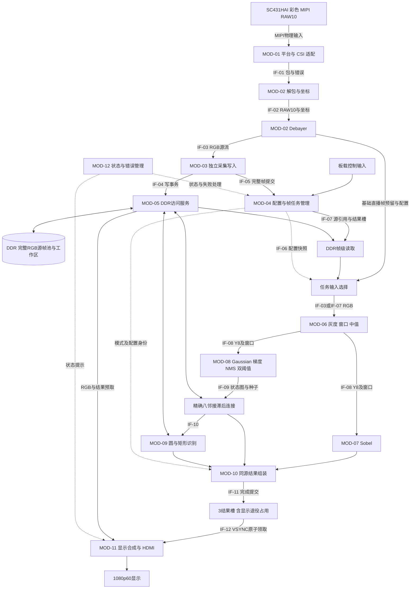

# 02 整体设计布局草图 v0.1

任务：TRACK4-FULL-SW-001；日期：2026-10-04。**这是整机设计提议与中文整体操作草图，不是已实现系统，也不是业务实现 READY_FOR_REVIEW。**事实依据见[前置调查](../01_baseline/preconditions-and-evidence.md)；用户范围见[需求](../00_scope/requirements-and-decisions.md)。

## 1. 整体行为与设计目标

输入是V4板上SC431HAI彩色MIPI流及板载控制输入。系统接收1920×1080源图像，完成灰度、可旁路中值、Sobel或完整Canny，可识别圆形/旋转矩形，以HDMI显示原色、原灰度/边缘对比、彩色边缘叠加和同源标注。单一整机保留全部功能，模式及参数按完整帧边界生效。

HDMI目标为1080p60。采集fps、有效处理fps、显示刷新率和重复帧数分别记录；慢模式取得最新完整源帧，显示保持最近完整结果。冻结的是可重复处理的RGB源帧，修改参数后产生同源新结果。识别无目标可以正常发布空标注；输入损坏、容量超限和处理失败不是“无目标”。

优化目标是在完整功能、身份正确、Canny精确连接、识别质量目标和合理时序条件下，提高有效吞吐、降低完成延迟、扩大有证据的识别覆盖能力。资源分配由整机预算决定；识别尺寸/数量/噪声/遮挡等当前是比较变量。

## 2. 普通文本布局图

以下图不依赖Mermaid渲染即可读。IF编号含义见[交接契约](../03_interfaces/handoffs-and-composition.md)。框是职责边界，不预定“一框一个RTL文件”。

```text
外部：SC431HAI MIPI RAW10                         外部：板载按键/拨码
              │ MIPI物理输入                              │
     MOD-01 平台适配/CSI/PLL/复位                 MOD-04 同步消抖、配置管理
              │ IF-01 包/像素输出与错误                    │ IF-06 配置快照/命令
     MOD-02 包校验/RAW解包/坐标/Debayer                     │
              │ IF-02 RAW10 → RGB；IF-03 同源RGB流          │
              ├───────────────→ MOD-03 独立采集写入         │
              │                         │ IF-04 DDR写       │
              │                         ▼                  │
              │                  MOD-05 DDR访问服务         │
              │                         │                 │
              │                    DDR RGB源帧池           │
              │                         │ IF-05 完整提交     │
              │                         └────────→ MOD-04 帧/配置/任务调度
              │                                            │
              │ 基础直播同源计算                            │ IF-07 最新完整帧/冻结帧
              │ （帧起点预留结果槽）                        ▼
              └───────────────┐                 DDR源RGB顺序读取
                              ▼                         │
                   处理输入选择器：每帧任务只选一个来源 ←─┘
                              │ IF-03或IF-07 RGB/身份/配置
                     MOD-06 灰度、窗口、可旁路中值
                              │ IF-08 Y8/窗口/中心坐标
                      ┌───────┴────────┐
                      ▼                ▼
                MOD-07 Sobel      MOD-08 完整Canny
                二值边缘          Gaussian→梯度/方向→NMS
                      │           →双阈值→DDR状态图
                      │                  │ IF-09
                      │           所有强边种子、精确8邻接滞后
                      │                  │
                      │                  ├── IF-10 → MOD-09 圆/矩形识别
                      │                  │              │ 同源标注
                      └─────────┬────────┴──────────────┘
                                ▼
                    MOD-10 结果写入/同源显示bundle组装
                    RGB源引用+边缘+标注+模式+frame/config/epoch
                                │ IF-11 全部必需写响应成功
                                ▼
                       3结果槽：显示 / 待发布 / 在建 / 退役角色
                                │ IF-12 VSYNC原子领取
                                ▼
                    MOD-11 预取/灰度对比/叠加/标注/HDMI
                                │
                           外部：1080p60显示

MOD-05同时服务采集、处理、状态/队列、识别和显示；不能长时间锁总线。
MOD-12状态/错误通道接收全部模块事件，送给MOD-04决策及MOD-11状态显示。
MOD-01向所有域提供时钟/复位/就绪；跨域数据和命令以FIFO/握手传递。
```

## 3. 可渲染布局图



图中的基础直播旁路是本次整体架构提议，用于减少DDR RGB重复读取；其吞吐、FIFO容量和行窗口并行处理必须在局部设计中证明。不得把这条箭头作为已验证性能。

## 4. 模块职责、拥有者与划界理由

| MOD | 一句话职责、输入/输出 | 拥有的数据/状态；边界 | 实现来源 |
|---|---|---|---|
| 01 平台 | 将V4时钟、复位、CSI、DDR PHY、HDMI专用资源接入逻辑模块 | PLL/校准就绪及域复位；不判算法正确 | 原v6受保护IP及peri候选，版本/许可/模型需验证 |
| 02 相机 | 校验包/帧，解包RAW10，建立坐标并生成RGB源像素 | 行缓存、RAW相位、包计数；不持有冻结帧或改变DDR调度 | 原解包/Debayer可调查适配；保精度是新设计提议 |
| 03 采集 | 不受算法反压地写独占源槽，完整且写响应成功后提交 | 当前写槽、事务计数、帧错误；不覆盖只读源 | 新帧所有权策略，复用写FIFO/DDR结构前核对协议 |
| 04 控制/调度 | 同步消抖、配置版本、源/结果槽引用、模式/冻结及帧任务 | 全部槽角色与引用、待用配置、任务状态；不直接算像素 | 自写职责，需完整局部状态设计 |
| 05 存储服务 | 多客户端DDR访问、响应路由及期限/公平服务 | 有限请求/响应队列、地址权限、水位；不拥有图像业务含义 | 复用控制器候选并新增受控访问服务 |
| 06 图像前端 | RGB灰度、有效像素窗口、可旁路中值 | 行历史/边界/任务身份；不修改正在处理的配置 | 自写定点/窗口/排序网络，不能据旧注释认定已有Sobel |
| 07 Sobel | 3×3梯度、绝对值和、阈值输出 | 局部流水/边缘数据；不实现Canny滞后 | 自写 |
| 08 Canny | 完整所有阶段，计算强边经弱边8邻接可达集合 | DDR分类/访问状态、有限种子/工作队列、任务进度 | 自写；局部缓存/并行结构由预算比较 |
| 09 识别 | 从边缘/梯度生成圆与矩形候选，原分辨率核验并输出标注 | 共享累计/几何工作区、有限候选和结果列表；不扩展为任意类别 | 几何检测提议，开发比较后冻结范围和质量评估 |
| 10 结果组装 | 收齐各输出并确认写完成，形成不可变显示bundle | 在建结果槽、完成条件；不直接切显示域指针 | 自写 |
| 11 显示 | 预取同源RGB/边缘，灰度对比、叠加和标注，保持HDMI时序 | 显示bundle、预取FIFO、扫描坐标；不读未完成结果 | v6 HDMI编码/专用IO候选，合成与原子换页自写 |
| 12 状态 | 统一记录采集/调度/算法/显示错误和分模式计数 | 状态快照/累计计数；不能由“无目标”掩盖算法错误 | 自写；仿真可观察，真实调试接口另行设计 |

划界依据是不同推进条件与数据所有权：相机不能暂停，任务读取能反压，显示时序不能停，DDR是共享有限服务。像素算法可以共用前端；完整Canny和识别需要有界帧级工作区，因此单独管理任务。

## 5. 双路径及模式组合

| 路径/配置 | 数据来源与运算 | 发布与显示 |
|---|---|---|
| 基础直播 | 同一相机RGB流分支：独立源帧写入，同时灰度→可选中值→Sobel；SOF预留结果槽并锁配置 | 源帧和结果均完整才发布；灰度对比可从显示所读原RGB即时转换 |
| 冻结Sobel | 已固定完整源RGB经DDR读取，进入共享灰度/中值/Sobel | 保持源frame_id，产生新config_id完整结果 |
| Canny | 调度器预留输出槽后领取最新完整或冻结RGB，顺序读取，高斯→梯度/方向→NMS→分类→精确连接 | 处理期间采集继续，显示最近完整bundle |
| Canny+识别 | 完整Canny结果交给分时圆/矩形候选与全分辨率核验 | 边缘、标签和源RGB合在一个bundle；无目标用合法空列表 |
| 展示布局 | 原色/原灰度/灰度边缘对比/彩色叠加/标注是显示配置 | 配置随bundle生效，不能新布局解释旧格式 |

共享前端一次只属于一个任务。冻结或帧级Canny工作时，相机RGB仅由独立采集路径写入；不能让慢任务停顿传播到CSI。模式转移排空旧前端事务后在下一SOF/新任务边界换输入来源。

基础直播SOF没有结果写槽时，本帧仅采集、不启动基础计算，记录算法调度跳帧。没有源写槽或采集FIFO溢出则是采集失败，不能算上述跳帧。队列水位及源槽周转能力需后续局部设计证明。

## 6. 帧、配置、所有权和有限缓存

- 全链路身份是 `(reset_epoch, frame_id, config_id)`；源RGB只绑定采集身份，结果增加算法配置身份。各输出保留原图坐标，窗口中心与输入位置的偏移必须显式适配。
- 初始预算为 **6个RGB源槽、3个结果槽**。源角色可能包含正在采集、最新完整、处理中、冻结、当前显示关联、待发布关联；角色可以共享同一不可变源的引用，但容量证明不依赖必然共槽。
- 源槽仅在无读者且非保留角色时可写。冻结、处理和显示各持有独立只读引用；旧“最新完整”被替代只释放自己的引用，不能释放其他消费者的引用。
- 结果槽可有 `WORKING/PENDING/DISPLAY/RETIRING` 角色，但全池只有3槽，四种角色不能同时占4槽。待发布队列深度1。VSYNC后的旧显示进入RETIRING，读/预取归还确认前仍占槽，不能当FREE；在建完成但pending占用时保留结果，不覆盖、不锁DDR。没有输出写槽的新任务在领取源帧之前等待。
- 每个任务源绑定自己的WORKING结果槽，不另持一个脱离结果槽的处理源。至多3个结果槽关联源（包括RETIRING），再加freeze/latest/capture至多3个独立角色，因此6源槽覆盖该峰值。pending与旧显示退役时禁止超额授予新任务，减槽必须重新证明。
- 源帧写入和结果写入都要等全部DDR响应成功。帧错误或可恢复事务错误使当前事务无效，正常排空响应后才回收；控制器失效导致无法排空时保持隔离直到安全复位确认，避免重用地址收到旧写响应。
- VSYNC时显示只领取一个完整bundle；旧bundle在扫描与预取读事务归还后释放源/结果引用。若无新bundle，整帧重复旧bundle。
- 配置输入经CDC与消抖后成为待用配置；直播SOF或帧任务领取时使用已经提交的完整快照。同沿新命令不修改旧快照，在下一允许边界生效；最终逐拍定义在局部设计中明确。
- 冻结默认固定当前显示bundle对应的完整源；尚无源画面时等待第一份完整源。冻结期间采集继续；参数更新为该源安排新任务，旧显示保留至新结果完整。
- 恢复直播只释放冻结引用，不撤销仍在处理/显示的引用。任务取消先停止发新请求，排空在途事务，再使结果无效并归还资源。

这是整体所有权协议，不是已实现引用计数器；增减同沿合并、CDC确认、ID位宽和溢出等需局部设计。

## 7. 时钟、复位、引脚与数值规划

| 对象 | 现在有依据的内容 | 必须在局部阶段冻结/验证 |
|---|---|---|
| V4输入 | 原peri有25/27MHz输入，板资料另有50MHz；四PLL候选 | 原理图→封装pin→bank电压→peri→端口逐项对应，PLL冲突/输出关系 |
| CSI | 实际引用4lane/HS_BYTECLK70MHz配置；原SDC相关端口100MHz | 发端模式、实际各输出时钟、包/行突发、字节/像素关系；不能猜一个数字替代调查 |
| DDR | 参数tCK2500ps，CK400MHz、x16双沿800MT/s理论值，AXI128bit | 真实模型校准、用户时钟、事务地址单位、时序和服务能力 |
| 图像计算 | 首选比较2像素/拍，100MHz时理论200Mpixel/s；4像素/拍作为比较点 | 窗口跨lane、FIFO、气泡/停顿、资源、真实Fmax及有效吞吐 |
| HDMI | 2200×1125×60=148.5Mpixels/s，双像素74.25MHz时序预算 | 编码/串行时钟来源、IO规范、相关时钟关系、IO/内部STA |
| 数值 | 外部RAW10；RGB888/Y8作为源与算法接口候选；Sobel绝对值和 | Debayer保持精度及RGB缩窄、灰度系数、signed/扩展、NMS方向、阈值单位、边界策略 |

原SDC的USER_PERIOD占位、exclusive分组和时钟冲突都是待整改设计事项。同步派生时钟不能随意当异步排除；异步域必须有明确同步/握手/FIFO及CDC依据。每个例外需说明覆盖对象、正确性依据与检查；未约束端点和报告警告必须分类，不能靠生成bitstream判断约束合理。

复位按域安全释放，禁止新事务直到依赖就绪。源/结果/窗口有效性及epoch冲刷，不假设清零整个DDR。旧epoch响应即使到达也不能发布为新结果。DDR校准失败/接口不可用时切换不依赖DDR的安全图案；硬件时序、上电与真实Bayer仍等待实物验证。

## 8. 容量、带宽和资源预算

令N=1920×1080=2,073,600。以下是紧凑布局逻辑大小，不含stride、对齐、控制器保留区及总线放大。

| 数据 | 每帧/工作区字节 | 预算用途 |
|---|---:|---|
| RGB24 | 6,220,800 | 6源槽=37,324,800B |
| 灰度8bit | 2,073,600 | 需要保存滤波图时；原灰度对比可即时转换 |
| 幅值16bit | 4,147,200 | Canny/NMS/识别候选 |
| 方向8bit容器 | 2,073,600 | 逻辑实际编码可更窄，局部设计决定 |
| 分类2bit | 518,400 | 弱/强/状态图 |
| 访问标记1bit | 259,200 | 可评估与分类编码合并 |
| 边缘1bit | 259,200 | 3结果槽=777,600B，容量不等于只需这些总线字节 |
| 32bit索引队列 | 8,294,400 | 精确连接最坏N条；像素每次仅入队一次 |
| 上述小计 | 55,468,800 | 约52.899MiB；尚未含识别、对齐、描述符与其他图像 |
| 可选RAW16诊断 | 4,147,200/帧 | 非默认全时保存；启用必须另列流量与空间 |

板载2Gb的容量按268,435,456B=256MiB核算。容量看起来有空间，不能据此判断DDR带宽或片上RAM足够。最终地址图在MOD-05局部设计建立，并做区域不重叠、边界和访问权限检查。

在采集60fps假定下：RGB采集写373.248MB/s，显示RGB读373.248MB/s，合计746.496MB/s。每个60fps打包1bit边缘读/写方向为15.552MB/s；基础同源流计算避免另加373.248MB/s源RGB重读。如果全部从DDR重读处理，仅采集+显示+该次读已经1,119.744MB/s，未含中间图/识别/队列和开销。

DDR理论峰值1.6GB/s不是有效带宽。50/60/70%效率只作800/960/1120MB/s敏感性比较，不选其中一个当实测值。显示和采集需要按最坏突发确定FIFO容量、最长服务间隔和预取期限；后台算法分段访问并保留最小推进额度，避免永久饥饿。

精确滞后最坏约8N=16,588,800邻居检查；若1邻居/拍，理想100/200MHz分别165.888/82.944ms，未计DDR等待。若每次状态访问消耗完整16B拍，只有邻居读就可能约265.421MB/最坏帧；必须比较邻域/块缓存、合并写回、队列顺序突发，不能只按2bit状态大小算实际带宽。

本机Ti60F225报告容量为60,800 XLR、256 Memory Blocks、160 DSP。工具RAM10模型有512×20/1024×10等模式；按256×10,240bit候选容量计算约2.621Mbit，但实际宽深、端口、碎片、同址冲突和全系统占用仍由综合/布局报告确定。此前给识别私有2.8Mbit的粗预算不能成立为已可放置配置。

资源分配次序：先测平台/采集/显示固定开销 → 预算窗口/前端 → 优化Canny DDR局部性 → 识别采用分块/分银行共享工作RAM及顺序DDR。比较2/4像素、共享/独立窗口、DSP/移位加法、缓存与突发；每点同时记录真实占用、STA、fps、最坏延迟、交易量和错误。几何尺寸、角度、数量、遮挡、噪声、纹理/对比是质量—性能—资源评估轴，最终独立验收范围须后续冻结。

## 9. 中文整体操作草图

### S-01 启动与基础直播

1. 读取上一个已提交的复位/PLL/DDR就绪状态；未就绪时不授予源/结果写槽，HDMI输出安全图案，状态标“等待”。
2. 各域冲刷确认后，源/结果槽为空，配置寄存器拥有完整默认值；采集器等待合法SOF。I2C配置和相机输入契约需本地设计确认。
3. SOF到达前，调度器按旧状态判定空源槽、空结果槽和已提交配置。采集获得源槽；基础计算如获得结果槽，则锁同一个frame_id及配置快照。本边沿到达的新控制命令不改变本帧快照。
4. 接收RAW包，验证类型/长度、行帧计数，解包与Debayer形成带坐标RGB；RGB独立进入采集FIFO并写源槽。同源计算分支经过灰度、可旁路中值、两行窗口、Sobel和阈值，写匹配的打包边缘结果。
5. 算法计数按实际像素接受推进，窗口与sideband一起延迟；边界像素按局部冻结的策略产生明确结果，不把无效当零。相机不能等待计算链ready，帧级接纳能力要预先证明。
6. EOF且像素/行数正确后，继续等待所有源与结果DDR写响应；全部正常才各自提交完成。任何输入错误使源及该帧计算结果无效，不能发布半帧。
7. 完成组装同源bundle；pending空时提交，否则保留完成结果并让其他独立路径推进。VSYNC由显示领取新bundle，原灰度可由所读原RGB即时转换，边缘/叠加按该bundle配置生成。
8. 旧显示读取和预取排空后归还引用；源池按实际角色释放，采集继续下一帧。没有新结果则完整重复旧结果并计数。

### S-02 最新完整帧、完整Canny与识别

1. 处理器空闲且输出写槽可预留时，按旧槽状态选择最新完整源；没有源则等待，不持有DDR锁。领取源只读引用和当前完整配置快照，记录frame/config/epoch。
2. DDR顺序读源RGB，共享前端接受后形成灰度/可选中值；完整Canny依次计算Gaussian、梯度/方向、NMS和强弱分类，写工作区。
3. 分类图写完成后，扫描所有强边作为种子；建立有限工作队列。每次从队列取已接纳像素，核验合法8邻居，对可达弱边只接纳/入队一次。队列空且状态更新写响应排空才结束连接；孤立弱边不保留。
4. 识别启用时，从同一最终边缘及梯度产生圆/旋转矩形候选，分时复用累计和几何核验资源；原分辨率核验和去重后形成有界列表。候选/输出溢出报告容量错误，合法空列表报告“无目标”。
5. 收齐边缘和标注必需写响应，组装bundle并发布；处理中相机继续采集完整新帧，旧待处理完整帧可被最新帧替代并计数。
6. 显示重复最后完整结果直到VSYNC领取新bundle。分别统计计算周期、DDR等待、输入fps、处理fps、结果年龄及跳帧，不以显示60Hz作为Canny/识别60fps。

### S-03 冻结、修改参数、恢复

1. 同步并消抖后的冻结命令交给MOD-04；取得当前显示bundle源引用，确认完整后增加冻结引用。无有效显示源时等待第一份完整源。
2. 采集路径继续更新其他槽；冻结引用的RGB不可写。阈值/滤波/算法/识别配置更新成为新config_id，当前在途任务仍用旧快照。
3. 有空结果槽时，对冻结源安排新任务。来源不变、配置身份改变；旧完整显示保持，直到同源新配置结果完成、全部响应成功且被VSYNC领取。
4. 多个参数事件可合并为下一任务的完整待用配置；取消或重新排程策略须在局部设计明确，不篡改在途输出。
5. 恢复命令解除冻结角色，但处理中/显示引用各自保留；共享前端完成排空后，基础直播从下一SOF恢复，慢模式重新领取最新完整源。

### S-04 容量、错误、取消与复位

1. 基础结果槽未预留：只跳过本帧算法，采集继续；没有源槽、FIFO溢出、坏包/坏行则使采集帧无效并在下一SOF重同步，单独报采集错误。
2. 普通任务取消/可恢复事务错误且DDR仍可用时，停发新请求并排空后作废工作槽；DDR校准失效或接口不可用时，停相关访问并切独立于DDR的安全图案。响应无法排空的故障使槽保持隔离，等控制器和客户端安全复位确认后恢复，不能强制归还、校准done或把AXI假模型记器件级通过。
3. 识别无目标：发布同源空列表；候选/队列/结果容量超限：报告限制并保留失败记录，不静默截断伪造成功。
4. 显示预取欠载：HDMI时序继续，输出明确安全画面并计数，不拼接未完成新帧；最坏服务能力不足时整体性能验收失败。
5. 复位依据旧epoch使全部在途任务不可发布，各域完成安全冲刷/释放；DDR不用全清零。就绪条件恢复后从新epoch/合法SOF重启，旧响应无法建立新结果。

## 10. 本轮整体检查点与下一层

11项REQ均有承担模块；主路径、分支/汇合、配置、错误和资源归还已经在系统层描述；正常、冻结、慢处理、失败路径可读回。对应逐连接检查和验证追踪见03/07。

本轮完成的是整体布局及设计调查。匹配DDR模型/PHY校准、受保护IP兼容、相机相位/真实时钟、引脚SDC、各模块完整局部中文草图与逐拍数值契约、真实资源和识别范围尚未完成。不能标业务实现READY或生成源码。下一层以04的功能分批和05阻塞清单继续，不跳过整体→交接→局部的顺序。
