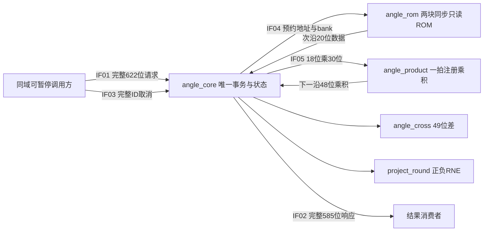

# TRACK4-ALGORITHM-R3-ANGLE-001：角度与投影模块设计 v1.1

设计状态：**READY_FOR_REVIEW / NOT_APPROVED / NOT_IMPLEMENTED / NOT_RUN**。本版在已完成全文读回与34项候选输入核查后，记录审批前的设计阶段；数学/接口/20文件范围与未呈现草稿v1相同。最终v1.1基线与外置评审再次绑定本版实际字节。

## 通用计划字段与阅读入口

- Goal：完成识别所需kind8梯度角、kind9径向角、kind10点投影、kind16系数的独立RTL及软件验证。属于完整A6数值路线的下一模块，完整圆/任意旋转矩形识别继续保留。
- Current state：R1/R2流段和R3 kind0–7整数核已有真实交付；本批只有设计，NOT_IMPLEMENTED/NOT_RUN/NOT_APPROVED。
- Target state：20份业务文件及一致中文草图，常数独立证明与核验、模块单测、真实观察顶层、Ti60F225/I3四pin25MHz综合/布局布线/STA及必要检查通过后的bit/hex登记。
- Gap：指定本版范围与基线尚未获用户批准；实际生成器/仿真/工具结果是获批后的验证义务。
- Assumptions：单同步域、调用方可暂停；W为偶数6…1920、H5…1080，生产目标保持1920×1080。不是将整机降为四pin实验。
- Open questions：本独立模块数值和时间契约见B–F；R4 caller适配、拟合/候选/质量、生产调度/性能和资源共存继续OPEN，但不作为本单模块编码前置。
- Dependencies：现行根v0.2/模板；R3总设计v0.2数值；原NUMERIC；已交付R3的复位/四pin配置/退出与STA经验。无需DDR模型、联网、C++或新工具。
- Milestones：本稿整体与局部草图→基线/读回评审→指定批准→常数核验→helper/core/probe单测→物理验证→登记bit后停止硬件步骤。
- Detailed steps / State transitions：E给出逐沿状态，G给出模块到整合的次序；只有设计文档能在本轮写入。
- Artifacts and hashes：输入基线文件 `experiments/track4_algorithms_20261004/01_baseline/algorithm-r3-angle-baseline-v1.1.json`，ID `ALGO-R3-ANGLE-BL-20261006-v1.1`。最终hash及本状态的核查依据写读回报告，不在正文循环嵌入自身hash。
- Validation / Completion criteria：G的文字场景，获批后全部适用项运行且source/hash绑定；I/L区分独立模块与整包完成。
- Failure handling：首个已发生错误保持，输出完整原因；取消收尾后DROP；冷复位共同作废；工具失败保留日志，不发可用bit。
- Human approval gates：需批准本v1.1/20文件/基线及本批本地审计例外。DDR Q0和R3 scalar的已完成授权不覆盖本批。正式DB、Manifest、PROJECT_STATE、TASK_LEDGER和硬件节点不改。
- Rollback：新独立 `work/active/track4_algorithms_20261004/r3_angle`；原源、既有实现/产物和失败日志只读，不覆盖。新attempt留证据，必要语义变化先修订设计。

阅读次序：B整体四项行为→C交接→D格式与数学→E局部语句/逐沿草图→F语言/预算→G文件和验证→H追踪→I审批停止点。语句组织和数据提交都在E，不以外部系统计划代替内部设计。

## A. 来源、基线和批准边界

本批对应T4-A6与R3-REQ03/05/06/07。原图规模、负样本/重叠/遮挡、完整Canny、目标质量及全部十一项不变；本模块只输出数值，不输出识别成功。

| 实际输入 | SHA256 / 已读范围与作用 |
|---|---|
| 根v0.2 | 4E4680716458F75BDA157E6FD2E2D13D09A9E85B5A4F5F7FF0D906170C7BADB2；此前全文，本轮未漂移 |
| PLAN_TEMPLATE | 99B7DA32B92C225AA333637A2F4F4F5B8DF3307C914677C9C2DB77DB1BA7DE79；已全文读，采用通用字段/A–L |
| design-TRACK4-ALGORITHM-R3-001.md v0.2 | 6D071B0AADD685E1185A7BA41D58EC33441055D59C1BE7F399CE8C0B011F8C5D；当前D1–D5/E1–E8/F–L，kind8/9/10/16及ROM数值来源 |
| design-TRACK4-RECOGNITION-NUMERIC-001.md | 17C4A290414970260BBADC7B5286F6C6F5608E3B03E0FF38E08E3E5E1491F39A；本轮D/E角投影及错误字典；旧543/540消息不接入 |
| r3-canonical-review-v0.1.md | 真实hash列入基线；本轮全文，继承已valid保持/未暴露取消优先/首失败原则 |
| R3已交付reset_sync.sv | 2E3BBDA931097E8E7FC0B67FFD87D677DB242B9D623FD6BEE6BED71637127FFE；原字节复制，不修复或修改共享复位 |
| scalar_probe.xml/.peri.xml/.sdc | CBCA142F1964078289418F7403865B56F3656C8EFF30232021FAC0B4A9414F0E / F61F969F6689F37FFD7F7C4BF7F8CBC0E10017DA48AB38C60A6C3C3068500595 / 419BBAF9AC1D2FDEE86C4463E288189EEB0F6F864BA3BBB1B03B467C7CC06146；仅作为本批改名/新source清单的配置种子 |
| R3交付/实现检查点/退出运行器 | 真实hash纳入基线；已读报告/检查点及build脚本，采用实际fatal exit1及已布线数据库STA要求，不把旧PASS当新PASS |

本批不用R3 scalar业务源码；不修改其接口/算法，也不使用旧宏大R3的5732bit预算。为避免一笔小乘法经过192位核的144个部分积和外层事务，将角度局部乘法明确独立为18×30注册结果单元；是否映射DSP、映射几块由实际报告判定。该重要选择属于本次待批准设计。

R3-B02的常数生成/终止、B03的本四项位宽及B06的本批文件/观察工程在本文收敛。R3-B01旧key/R4调用、B04 profile/质量、B05全机仲裁、其他拟合与整机物理选择不被宣称关闭。没有旧key转换、profile实体、DDR对象或字体共享的隐含前提。

## B. 整体行为、结果和可检查要求

| REQ | 本批保证 |
|---|---|
| AN01 | 每个真实req_fire形成一个完整、可保持的原身份响应；共同冷复位作废单列。接纳后不接受第二请求，无组合旁路 |
| AN02 | kind8按冻结Q30边界分类为θ9，零梯度FRAME_FAIL/GRAD_ZERO；kind9保留θu10/half/fullbin/sector，零径向LOCAL_REJECT/DEGENERATE |
| AN03 | kind10用真实图内坐标、signed17 Q15系数和一次RNE形成q9/r9；kind16返回同一系数恢复结果；padding全零 |
| AN04 | 两ROM各20×512，静态且无写；只用预约读，次沿capture；常数由精确区间生成并被独立区间算法逐项核验 |
| AN05 | 请求/结果全文保持；匹配取消只影响未暴露结果，必须先收完旧ROM/乘积；已valid结果不改写；同步冷复位与caller/consumer共同作废 |
| AN06 | 有限存储与状态，无第二事务/历史队列。正常angle最多8次边界判断，固定私有形成上界96个core沿，cancel无held响应时≤3沿；外部输出背压不计计算形成界 |
| AN07 | 独立数学参考、真实握手记录、helpers/core/probe验证及物理路径同一来源绑定。常数、numeric和协议覆盖分别计，不以PASS掩盖未到达状态 |
| AN08 | 本批20文件及中文操作/代码追踪齐全，实际25MHz物理检查通过才生成登记bit；停止硬件步骤；不宣称整包性能或识别质量通过 |

正常例：G=(1,0)/(0,1)/(1,1)/(-1,1)分别θ0/256/128/384，G和−G输出同θ。径向(-10000,16)可形成θu512/half0/fullbin512/sector32；(10000,-16)形成θu512/half1，加法为1024，模后fullbin0/sector0。零向量分别按AN02分类，不返回伪合法角0。

投影例：θ0系数C32768/S0，W1920的x0给X2=-1919、q=RNE(-1919/16)=-120、r18；θ256/H17/y12给Y2=8，q=RNE(1/2)=0、r138，y4给-1/2同为0。负数不以带符号右移代替舍入。

本批只支持kind8/9/10/16；其他kind输出FRAME_FAIL/UNSUPPORTED，并回显原kind/target/ID。这个独立入口不是替换已交付0–7核或缩减最终0–18路线，未来统一dispatcher/拟合和R4调用另冻结。

## C. 模块职责、整体连接与组合检查

angle_protocol_pkg只命名布局/字典；angle_core拥有完整请求快照、当前向量、搜索/投影、pending和结果资格。angle_rom拥有两个静态ROM及读输出，angle_product只有一个结果pipeline，cross/round是组合数学，没有独立事务。probe是本批软件/物理观察调用方与消费者；它提供真实变化数据并消费真实结果，不参与生产识别。

上游稳定body至fire，下游可暂停。只有旧IDLE且无pending/held时ready，结果形成后至fire不变。ROM和乘积无ready，必须在发出时已预留目的；返回capture不能被外部rsp_ready阻塞。执行阶段不依赖新点或消费者释放其他资源，避免互等。取消消费方必须具有本地DISCARD资格，不等待普通目的寄存器。

ROM和乘法在不同步骤使用；没有二者同时未收尾的状态。旧capture可与下一RE/start同沿，但仍最多一笔ROM pending和一笔乘积pending。结果背压发生在私有计算已结束后，不再读常数或重复运算。

## D. 接口、表示及数学边界

### D1. 外部消息与错误选择

IF01低到高：NUM_ID176、W11、H11、numeric_version8、kind5、a_signed1、b_signed1、result_bits9、payload400，合622。NUM_ID低到高epoch32/frame32/config32/owner8/call_seq64/destination8；本批owner只能0，version只能1。caller保有非回绕序号；本核不存历史去重，不把destination当序号。

IF02低到高：原NUM_ID176、kind5、result_bits9、outcome2、reason8、value385，合585。VALUE0/reason0；LOCAL_REJECT1/DEGENERATE4只用于径向零；FRAME_FAIL2使用下表非零原因；CANCEL_DROP3/reason0。非VALUE的value385恒0，回显原kind/target，即使输入格式非法。

| 顺序 | 检查与本批结果 |
|---|---|
| 1 | W不在偶数6…1920或H不在5…1080：FRAME_FAIL/COORD3 |
| 2 | version≠1、owner≠0、kind不支持：FRAME_FAIL/UNSUPPORTED12 |
| 3 | 四种kind的flags或result_bits不是0：FRAME_FAIL/FORMAT2 |
| 4 | 表中payload padding非零：FRAME_FAIL/FORMAT2 |
| 5 | kind8 Gx/Gy逐字段不在±1020，kind9 abs任一分量不能收uint18，kind10 x≥W或y≥H：FRAME_FAIL/COORD3 |
| 6 | kind8两分量零：FRAME_FAIL/GRAD_ZERO1；kind9两分量零：LOCAL_REJECT/DEGENERATE4 |
| 7 | 已完成步骤的ROM编码/目的或状态不变量破坏：FRAME_FAIL/INTERNAL13；算术窄化失败：FRAME_FAIL/ARITH_OVERFLOW8 |

每个步骤首错锁定，失败不进入后项。不同步骤不抢先检查未来值；同一步内部不变量破坏优先于窄化。匹配取消优先于尚未暴露的错误/值，已valid响应则全文不变。径向零的reason4在本卡明确冻结，原总稿只指定LOCAL_REJECT而未给该分支专用reason；不是改动已交付scalar。

| kind | payload400低到高 | VALUE385低到高 |
|---|---|---|
| 8 | Gx s11/Gy s11/zero378 | θ u9/zero376 |
| 9 | dx s19/dy s19/zero362；范围各[-262143,262143] | θu u10/half1/fullbin u10/sector u6/zero358 |
| 10 | x u11/y u11/targetθ u9/zero369 | q s9/r u9/zero367 |
| 16 | targetθ u9/zero391 | C s17/S s17/zero351 |

IF03 cancel_valid/cancel_id176均同域；完整ID等于旧live或本沿req_fire的ID才匹配。错ID不改变状态。IF06 rst同步高有效，有效时屏蔽fire并作废全部资格；caller、core、helper及consumer共同复位。quiet只表示IDLE/无私有pending/无held结果，不证明外部DDR排空。

### D2. ROM与精确常数

IF04包含bank1、RE1、addr9、capture目的及word编号；目的为core私有元数据，不重复全ID。eK RE→eK沿后ROM输出寄存器更新→eK+1读取旧pending对应的稳定输出。两个ROM无WE；全512word初始化，只读输出20bit。地址计算先扩位，检查<512后收9bit。

边界ROM：k0…127，βk=(k+1/2)π/512，C=RNE(2^30 cosβ)、S=RNE(2^30 sinβ)，各u30。60bit低C高S，word3k低20、word3k+1中20、word3k+2高20；384…511全0。所有边界满足0<S<C<2^30。

投影ROM：k0…128，C=RNE(32768cos(kπ/512))、S=RNE(32768sin(kπ/512))，各u16；word2k为C、word2k+1为S，各word高4零，258…511零。0≤S≤C≤32768，axis k0=(32768,0)，对角k128的C/S相等。恢复符号时扩到s17，不能用s16存32768。没有font或共享ROM模式。

常数生成器只用Python Fraction/大整数，不调用浮点sin/cos作为RNE依据：

1. π=16atan(1/5)−4atan(1/239)，各atan用交错有理级数偶/奇部分和取得上下界；初轮8项，未分离时倍增。
2. 先证明π区间落在(3,4)，传播每个角的有理区间；所有角端点在[0,1]。sin/cos交错Taylor项幅度递减，取含首省略项的上下界；sin在[0,1]递增，cos递减，按对应端点传播。
3. 乘准确2^30或32768后，只有完整区间落在同一最近整数的half-cell才提交该整数。零角采用解析精确值。记录514个分量的轮数和证书区间，检查bit宽/padding，再写两份各512行、每行5位大写hex、ASCII/LF无BOM的.mem。
4. 每个非零角是有理π倍数。若sin/cos恰为二进制half-cell的(2j+1)/2^(Q+1)，其两倍可表示为单位根之和的有理代数整数，因此必须是整数，但(2j+1)/2^Q不是整数，矛盾。误差收敛到0，有限514分量均在有限轮分离。不得用固定浮点精度假定终止或正确。

独立参考用不同π恒等式 `π=4atan(1/2)+4atan(1/3)`：两个正角小于π/2，tan和式为1，因此和为π/4。其交错区间初轮12项/倍增；Taylor项直接幂/阶乘构造，与生成器递推分开。分别独立得到全部常数，并核生成器的分离证书与全部1024word。参考θ用逐个线性扫描128条边界，不能复制RTL二分作唯一oracle。未获批前不生成任何常数字节/程序。

边界单调性：相邻β间隔π/512。sin差在[0,π/4]下界大于半个角间隔，缩放Q30后远大于1；cos差的最小情形在最前区间，sin t≥t/2、β0>3/1024，积分下界缩放后仍>1。RNE后S严格增加、C严格减少且都正，故S/C严格增加，cross判定可二分。获批后还须全表整数检查，不能以证明代替实际文件核对。

### D3. 角折叠、恢复与位宽

先保存half=(原y<0)或(原y=0且原x<0)。half为1时在扩位域整体变号，使y≥0。kind8先检查±1020，kind9先检查abs≤262143，故最负值不会被窄化后取反。规范向量用s19，m=min(absx,y)、M=max，u18且M>0。

搜索lo=0/hi=128均u8。只在lo<hi时mid=(lo+hi)/2，和先u9，mid≤127。取得完整C/S后计算mC、MS两个u48乘积，在s49域计算cross。cross>0提交lo=mid+1，否则hi=mid；cross=0选择较小fold。最多8次后q=lo∈[0,128]。

恢复θu：x≥0且absx≥y取q；x≥0且absx<y取256−q；x<0且absx<y取256+q；其余512−q。运算在u10范围[0,512]进行。kind8单独θ=θu mod512收u9；kind9先u11形成θu+512half，再模1024收u10，sector=fullbin>>4。不能先收θu9再加half。

Q30表是位精确分类标准。每分量相对理想值误差≤2^-31，边界角扰动保守≤10^-9rad，最近角误差≤π/1024加该项；没有全输入分离证明时不宣称与无限精度实数分桶全域相同。原dir2未改成θ9。

### D4. 系数恢复、投影与舍入

targetθ0…511：0…128取k=θ的(C,S)；129…256取k=256−θ的(S,C)；257…384取k=θ−256的(−S,C)；385…511取k=512−θ的(−C,S)。先s17扩位再交换/取负。

kind10：X2=2x−(W−1)、Y2=2y−(H−1)先s13算、查范围后收s12；单位半像素。两个乘积各s29，P=X2C+Y2S在s30算。利用绝对值映射到同一18×30乘法器，完整u48结果先恢复到s49，再核可收s29，不能截低29位后再判断。

q=RNE(P/2^19)。先把P s30扩s31取绝对值；整数部分/余数19位分开，余数大于2^18进一，相等只在商奇时进一，最后恢复符号。project_round私有接口输出s13真值；core核[-138,138]及s9可表达，q+138先s10检查[0,276]再收r9。

完整1080p坐标给|X2|≤1919、|Y2|≤1079。Cauchy界及系数各半LSB误差给|P|<2202×32768+(1919+1079)/2=72156635，小于138.5×524288=72613888，所以合法图内q不可能舍入至±139。此界覆盖本W/H域，不能用小图替代全范围资格。q=0时r138自镜；角扩展θ+512系数变号，q变号，对应镜像276−r，不能把θ wrap后的r直接比较为同值。

## E. 局部数据、状态与中文语句草图

### E1. 共同事务、ROM与小乘法

angle_core时序主体采用一个case状态机及非阻塞提交，组合块只产生当前状态的RE/start和次状态资格。位段由pkg命名，避免散布622/585的magic offset。组合默认值覆盖全部分支，不推锁存。

1. IDLE的旧req_fire锁完整622bit输入，结果资格仍无效；同沿匹配cancel记sticky。CHECK按D1顺序检查旧快照；非合法不进入数学。PREP保存规范向量或targetθ的octant参数。
2. ROM请求前锁bank/地址/word目的。READ0发第0word；READ1同时capture旧第0word、发第1word；READ2只用于边界表，同时capture旧第1word、发第2word；READ_DRAIN只capture最后word。新capture内容下一状态才使用。投影两word直接从READ1到READ_DRAIN。pending旧消费与新预约同沿不是两份在途队列。
3. 私有angle_product接口为clk/rst/start/Au18/Bu30→Pu48/valid1。start沿直接将全宽乘积登记到结果寄存器并更新valid；下一沿core读取旧valid和结果。没有ready或另一个输入slot，core预先留好目的，下一沿必须capture或DISCARD。
4. MUL0发mC或abs(X2)·abs(C)；MUL1capture第一乘积并发MS或abs(Y2)·abs(S)；PRODUCT_DRAINcapture第二乘积；DECIDE只能使用两个已登记乘积。启动表达式在18/30输入域zero_extend，48结果域明确；是否DSP由工具实测。
5. PACK填VALUE/ERROR/DROP的完整385bit及outcome/reason，进入HELD后的沿才可rsp_fire。HELD保持全部body，包括错误响应；fire后回IDLE，下一沿才接新请求。

每个stage拥有自己的有效性：ROM输出值存在不等于当前pending，product值存在不等于当前valid，req.payload存在不等于新请求。目的/bank/k/word只随真正RE预约更新；其生命周期由capture结束。

### E2. 角度主路径的逐沿次序

接受e0→CHECK e1→PREP e2→SELECT e3。SELECT若lo<hi只登记mid/基地址，READ0 e4、READ1 e5、READ2 e6、READ_DRAIN e7，完整60bit提交后MUL0 e8、MUL1 e9、PRODUCT_DRAIN e10、DECIDE e11。DECIDE用旧两个产品和mid更新lo/hi，再回SELECT。每次边界比较9沿，至多8次。

SELECT发现lo=hi后→RECOVER用旧q/half/规范x/y恢复θu→PACK→HELD。上述路径正常形成≤80沿，冻结宽松私有上界96，避免把反压等待算成计算期限。TB需实际覆盖8次二分和各分支、记录最大形成沿；未测不报实测值。

angle_cross无时序状态：两个u48先各补0成s49再相减，输出cross s49/positive1。它的零判定由core采用cross>0；独立helper单测可用合成乘积检查零tie，不能把这种隔离案例当真实常数表必存在的tie向量。

### E3. 系数与投影主路径

CHECK→PREP保存k/交换/取负模式→SELECT登记2k地址→READ0/READ1/READ_DRAIN取得完整40bit。RESTORE先核高4padding、分量≤32768及octant关系，再在s17恢复C/S；kind16直接PACK。

kind10再COORD形成X2/Y2→MUL0/MUL1/PRODUCT_DRAIN→SIGN恢复两个全乘积符号并核s29→SUM登记P s30→ROUND登记私有q s13→QUALIFY核q9/±138并登记r→PACK/HELD。每次使用的都是旧已提交值，不在ROUND同沿读取新P，不在QUALIFY同沿读取新q。

ROM高padding或非法编码为INTERNAL；数学全值不能收合法目的为OVERFLOW。常数内容完全匹配由生成/独立审核/hash证明，不声称运行中编码检查能检测所有存储位翻转；本批无新增ECC或故障容错指标。

### E4. 取消、共同复位与不变量

每沿先记录旧req/rsp fire及旧ROM/product返回。rst有效时共同作废；否则旧HELD响应优先保持，匹配cancel不重写。其余状态的匹配或sticky cancel优先于新私有结果/错误，并组合禁止本沿新RE/start；旧返回仍capture后DISCARD。

若无pending则准备DROP；若有pending进入DROP_WAIT收旧预约返回后准备DROP。固定一拍返回且没有新发，最晚3沿形成CANCEL_DROP/reason0/value0。输出已valid的任何outcome都按原body消费，消费者另记DISCARD。错cancel ID不产生sticky。

同步冷rst清所有valid/pending/状态/计数资格及helper valid，不功能清零ROM；调用方和消费者同时记录被复位作废的请求。rst有效期间fire为0，释放后第一个合法IDLE req_fire即可接纳。不把cold reset当DDR或暖复位排空证书。

INV01 accepted=consumed+live+reset_aborted；INV02 live≤1且HELD body不变；INV03 ROM/product各pending≤1且每返回有预约；INV04 onlyfire推进外部请求序号；INV05 capture后下一状态使用；INV06窄化前全值检查；INV07搜索区间单调缩小并保[0,128]；INV08 cancel不撤旧响应、不等新业务输入；INV09错误value0且保原身份。

## F. 语言、有限资源与三份映射

RTL SV2009，二补码，explicit signed/zero扩位，时序非阻塞/组合阻塞，无锁存/动态内存/运行时浮点。Python3.14.6标准库Fraction/整数是数值参考，既有PowerShell7为工具编排；C++为N/A，因为本批不生成C++。

| RTL A–L | 合同 |
|---|---|
| A | D中的所有字段/宽度/扩位/RNE；无饱和回绕、无signed16系数、无提前压θu9 |
| B | 单正沿，同域输入preedge稳定，old fire/capture先算、沿后提交；TB在更新稳定后观察，下一preedge消费 |
| C/D | req/rsp各valid&&ready；无fire不接纳；RE/start是有目的的私有事件，valid0不当零向量 |
| E | 输入与输出全文保持；固定返回不得因rsp_ready暂停；预约目的独立于普通业务输出 |
| F | angle≤8次/每次9沿，所有合法调用私有形成≤96；cancel无held≤3；输出背压墙钟等待无有限上界 |
| G | 同步高rst共同作废，清资格不清ROM；probe外部KEY经原两级reset_sync接入 |
| H | W/H/version/kind/输入在req_fire快照；ROM静态不可写；不查可变全局配置 |
| I | 两20×512 ROM，各1R无WE，次沿capture；FF保持一个请求和一个响应；地址/目的有效性检查 |
| J | 原NUM_ID176不截短；原图x/y；θ9、θu10、half与fullbin分开；输入一笔输出一笔，无帧裁剪 |
| K | 本core无CDC；同域cancel/consumer。板外KEY只到已选复位同步器；其真实异步例外单独审查 |
| L | Ti60F225/I3/25MHz40ns观察工程；RAM/DSP映射和时序属于未来工具实测，全机≥生产视频节拍与共存仍待整合 |

有限容器预算（设计bit容器，不是实际FF/XLR）：请求622、响应385+outcome2+reason8=395；规范向量38、m/M36、half1、lo/hi/mid24、θu10；常数capture100、恢复系数34；两乘积96、helper结果/valid49；X2/Y2 24、两signed29产品58、P30、qwide13、r9；ROM目的26、product目的3、外层状态/标志预算64，合1632bit；另两ROM读输出40bit，总1672。冻结core预算≤1900bit容器，不藏另一个全消息slot。

probe约1800bit容器预算：真实源LFSR192、请求622、响应串行585、seq64/CRC32/bit_index10/状态计数LED/reset同步。core+probe≤3700bit容器；实际映射目标≤24000 XLR、2 RAM10、≤8 DSP。乘法表达式不承诺一个DSP；原工具可能裁常量padding，须记录实际布局/扇出。预算超出先审查映射或按规范修订结构，不能降1080p/功能/质量。

共同数值合同：reference独立线性θ查找、整数投影/RNE及全部385bit终态；常数独立区间核对。硬件执行合同：E沿事件/目的/保持/取消/复位，不用函数返回替代。对应合同：一笔软件请求对应实际req_fire的ID/kind；正常/拒绝/失败逐位，未暴露取消比DROP，已HELD取消比旧body并记DISCARD，reset_aborted单列。

## G. 20文件清单、观察顶层和验证计划

### G1. 获批后生成的业务文件

新work根r3_angle，仅下列20文件：

| 分类 | 文件与职责 |
|---|---|
| 6 RTL | rtl/angle_protocol_pkg.sv；rtl/angle_math.sv（三private helper）；rtl/angle_rom.sv；rtl/angle_core.sv；rtl/reset_sync.sv（原字节）；rtl/angle_probe_top.sv |
| 2 ROM | rtl/angle_boundary.mem；rtl/projection_coeff.mem，必须完整512word并独立核验 |
| 3参考/向量 | model/angle_constants.py（精确生成/证书）；model/angle_reference.py（独立常数和数值/记录审核）；model/angle_vectors.py（场景生成） |
| 3 TB | tb/tb_angle_helpers.sv；tb/tb_angle_core.sv；tb/tb_angle_probe_top.sv |
| 3运行支持 | scripts/run_angle_sim.ps1；scripts/run_angle_build.ps1；scripts/postroute.tcl |
| 3工程 | project/angle_probe.xml；project/angle_probe.peri.xml；project/angle_probe.sdc |

每个attempt产生的JSON证书/向量/.do/原日志/波形/快照/STA报告属于上述runner的派生产物，不是额外功能范围。中文module-code-reading/操作追踪/DELIVERY写docs，最终与真实状态/符号同步。

模型用本机已有Python。ROM默认初始化参数明确指向既有ASCII junction下 `C:/Users/34528/FPGAEdgeLinks/Work/active/track4_algorithms_20261004/r3_angle/rtl/angle_boundary.mem` 和projection_coeff.mem；不依赖工具临时cwd猜路径。sim可指定同hash快照绝对路径。物理runner保存两表快照并在每阶段前后核原初始化路径字节与快照一致，明确登记实际readmemh路径。跨机器便携性尚不作为本批通过结论。

实施顺序：常数生成/独立核验→math helper→core/协议→probe/参考观察→Map/接口/PNR/STA→报告评审/门槛→Bit/登记。不得为了提前工具PASS先删内部警告、静态化真实数据或跳过RAM检查。

### G2. 真实probe、引脚和物理覆盖

probe默认W1920/H1080，epoch1/frame0/config1/owner0，seq64只随实际req_fire非回绕，destination回显kind。seq低2位轮换8/9/10/16。192位非零LFSR在fire时左移一位，feedback=bit191 XOR190 XOR187 XOR185；不宣称最大周期。

梯度用源低两组10bit幅值，1021…1023归1020；双零将第一幅值改1，bit20/21选符号。径向用低两组18bit幅值，双零改第一为1，bit36/37选符号。project x取低11bit，≥1920则减1920；y取次11bit，≥1080则减1080；θ取bit30…22。coeff θ取bit8…0。输入来源/合法化必须被独立审核，不能只比较core输出。

响应真实消费后585bit最高到最低串行送CRC32（poly04C11DB7、初FFFFFFFF），记录真实req/rsp/CRC。CRC完才下一请求，不覆盖待观察结果；每1024实际消费LED0翻转，LED1为CRC低bit。seq用尽停发，不回绕。1024正常＋冷复位后32请求形成1056笔源/响应/CRC参考核验；不换算为生产fps。

工程改名/source列表，Ti60F225/I3/SV2009/25MHz。J2 clk_25m为1A1.8V GCLK；P13 key1_n、N14 led0、P14 led1为BR3.3V/LED drive4。KEY只到原两级SR异步置位例外，级间D与核心同步复位路径必须检查；LED板外异步观察例外只到实际输出。不得复制整核false_path。

postroute脚本属于本批可复现STA入口，查询实际map寄存器与已布线数据库，含source→request→core、ROM地址→真实RAM输出/数据、乘法与compare/round→rsp、response_shift→CRC→LED D路径。端点限数据D，不能以CE/clock/SR或空collection替代。需要RAM读时序/真实数据扇出、setup/hold、all_registers、内部unconstrained/no_clock/multiple_clock及所有例外清单。PNR/STA必须是同快照与路由输入，helper两ROM不能只在仿真出现。

### G3. 文字场景（当前全部NOT_RUN）

| TEST | 输入/方法与明确判定 |
|---|---|
| AN-T01 常数 | 全514分量两种独立π/区间算法逐项一致；完整1024word/bit布局/padding/证书/单调性，独立轴/对角校验；任何未分离或不一致失败 |
| AN-T02 helper | 18×30零/最大/单bit/混合位，连续start和气泡、冷reset；cross正负零用独立合成产品，投影RNE的±0.5/±1.5/±2.5及最负P30；比较下一沿valid和完整结果 |
| AN-T03 梯度 | 四轴/对角/对立向量；全部128边界在M1020下m=floor(MS/C)的-1/0/+1，8个符号/交换恢复；2048随机seed20261009；独立线性扫描，覆盖0和128 fold及8比较路径 |
| AN-T04 径向 | 上述π跨界/1024 wrap反例、轴、全18bit幅值/最小非零、零/最负非法；各128边界M262143邻域及8恢复；4096随机seed20261010；核θu/half/fullbin/sector完整27bit |
| AN-T05 系数 | 所有512个targetθ，含32768、128/256/384/511、交换和取负；完整34bit及高351零 |
| AN-T06 投影 | 1920×1080九点（四角、四条边中点、一中心点）×512角=4608；6×5全部30点×512角=15360；另W16、H17/49/81的±0.5/±1.5/±2.5 ties；全值RNE/9bit符号/r镜像/padding。完整域资格与小图全点测试分开 |
| AN-T07 格式/首错 | W/H边界/奇W、版本/owner、unsupported kind、flags/target、各payload padding、G±1021/径向-262144、越图point、零向量、同时多错误；按D1固定顺序比完整错误响应 |
| AN-T08 保持/互斥 | req/rsp各1/7/31/257沿停顿，持续第二请求/气泡、响应形成时ready、消费同沿第二offer；全文保持、live计账、无新副作用、96形成上界 |
| AN-T09 取消 | 错ID；同req_fire、CHECK错误同沿、每个ROM请求/capture、连续两个乘积、DECIDE/SIGN/ROUND、PACK、已HELD、同rsp_fire、sticky拉低。旧返回先结账，未暴露DROP≤3，旧HELD任何outcome均不改；逐状态覆盖 |
| AN-T10 冷复位 | IDLE、全部非HELD执行状态、各pending、held VALUE/ERROR/DROP；联合清资格、作废计账、不返伪响应；下一不同ID恢复 |
| AN-T11 probe | 正常1024＋恢复32，共1056笔真实源/响应/CRC独立审核，source recurrence/合法化亦核；故意fatal退出探针真实exit非0且无成功JSON，正常TB/audit退出0 |
| AN-T12 物理 | 同20文件快照/常数审核/完整仿真PASS绑定；Map/PT/PNR/STA实际exit0，2RAM真实扇出及data D paths、非空collection、25MHzsetup/hold≥0、内部未约束0、pins/例外合理；然后Bit、hash/staging登记并停止硬件 |

数值生成和实际case计数/去重/子状态覆盖记录在manifest；不把未来计划数量当已执行数量。随机种子固定，不能以恰好通过的另一种seed覆盖旧失败。ROM tie helper测试与真实表/输入的tie是否可达分开，未到达的真实tie为NOT_OBSERVED，不冒充完整域覆盖。

run_angle_sim生成真实.do宏，onbreak根据finished资格退出；致错探针exit非0/无成功JSON，正常case必须finished=true/statusPASS/exit0，原始stdout/stderr/argv/cwd/PID/timeout全部留存。引用本机Questa/Python工具，不新安装/联网。run_angle_build按新RunId顺序Map/Interface/Pnr/Sta/Bit，每阶段必须前项成功/hash不漂移；Sta保存完整已布线输入，独立评审证据后Release gate再允许Bit。staging只登记本批，不晋升正式canonical或硬件通过。

## H. 双向追踪

| REQ | 模块/接口/草图 | 文件/TEST | 当前代码与证据 |
|---|---|---|---|
| AN01/05 | pkg/core、IF01/02/03/06、E1/E4 | pkg/core/T07–10 | 未生成/NOT_RUN |
| AN02 | core/rom/product/cross、D2/D3/E2 | core/math/rom/两mem/T01–04 | 未生成/NOT_RUN |
| AN03 | restore/coord/product/round、D4/E3 | core/math/T05/06 | 未生成/NOT_RUN |
| AN04 | 两ROM/预约/精确常数、IF04/E1 | rom/mem/constants/reference/T01/09 | 未生成/NOT_RUN |
| AN06 | 单live/finite FSM/目的、E/F | core/math/协议TB/T08–10 | 仅设计沿界与bit容器 |
| AN07 | 独立常数/数值/事件审核、F | 三model/三TB/sim/T01–11 | 未生成/NOT_RUN |
| AN08 | probe/reset/约束/STA/登记、G2 | probe/reset/三工程/build/T12 | 未生成/NOT_RUN |

反向：product和cross只服务角/投影乘积；round只服务2^19精确投影；两ROM仅常数；probe和CRC仅真实软件/物理观察。没有票表、点选取、拟合、DDR服务、font、R4 profile或画图逻辑混入。本批不依照这张表为无关代码补虚构需求。

## I. 门槛、保存/评审和实施停止点

十项证据：①B行为与正常/边界；②C职责/复用；③D接口及C的组合保证；④E状态/所有者/旧沿草图；⑤F语言/位宽及三份对应；⑥D/E/G正常/取消/复位端到端；⑦G/H完整20文件/测试/追踪；⑧本四项不依赖DDR/未定R4适配，常数和工具运行是批准后验证义务；⑨草稿已全文读回、34项候选输入一致，本v1.1最终字节/基线再核后向用户呈现；⑩v1.1/新work/20文件/基线明确。逐项审阅与实际读取范围见外置读回报告，数学说明不是常数/RTL测试PASS。

本稿READY_FOR_REVIEW，仅表示可呈现供指定批准，不表示实现或验证通过。用户批准前不生成RTL、常数、参考、runner、TB、工程或功能性原型，不通过代码块或子Agent绕过。本批需要单独指定本地JSONL/报告/副作用审计例外，正式DB未配置、正式状态不改。理解验收待用户实际反馈，不作为实施考试闸门。

## J. 差异、恢复与范围

总R3 v0.2使用共享192位算术的候选；本卡改为角/投影私有18×30一拍乘积，以降低小运算的序列步骤，最终位精确数学不变。新增独立π核验方法、精确20文件/时钟/pin、明确径向零reason4和96沿上界属于本版待批准范围。scalar原源码/批准/运行结果不变，其他拟合/距离不是本卡支持操作。

v1未向用户提出实施批准，原字节34798B/SHA C3CCABB8645B2330F7C42D9C3A8B3CBB7B5D1906928816E74EC92AC60982E982保存在design-TRACK4-ALGORITHM-R3-ANGLE-001-v1-draft.md，候选基线v1原文件亦保留。v1.1只明确文档阶段与最终唯一基线ID，数学/范围不变；候选v1基线不用于实施。恢复先核本v1.1/基线/批准/当前源码和先前run。任何数学、接口、错误、time/保持、cancel/reset、ROM结构或实际资源重要选择变动先记录并修订批准；同契约内部语句调整先同步中文草图。失败保留旧attempt，新RunId不覆盖旧日志或产物。

## K. 实录

本轮只读真实R3/原NUMERIC与已有交付来源，完成纯设计，不运行生成器，不生成业务源码/常数/功能脚本/TB，不执行EDA。设计版本的保存/读回/基线核查由外置评审记录证明；当前未批准。本批未使用网络/新工具/硬件/数据库，未改变原HDK或正式状态。

## L. 交付和最终整包关系

获批后交付必须按最终代码重新核pkg位段、状态更新、ROM目的与路径、乘积/舍入、cancel/reset、全部测试和中文说明的一致性；写docs阅读入口和GUI波形/Efinity操作。生成登记bit后停止下载/烧写步骤。

完整目标仍需拟合/交点/距离数值、R4支撑/候选/负样本/重叠/遮挡与P/R评价、完整八邻域Canny滞后连接、DDR动态资格及生产存储、SC431HAI/HDMI/CDC、阈值/冻结/彩色叠加、整包资源/时序/性能。独立25MHz/四pin和数值向量不证明生产视频或识别fps；本模块交付不会使十一项自动判定完成。
