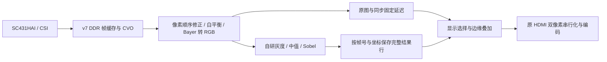

# 自研算法接入 v7：第一阶段交付

日期：2026-10-18。状态：仿真、综合、接口、布局布线与时序通过；尚待人工下载验证。完整 Canny、形状识别、冻结及按键尚未迁入本 bit。

## 架构改变

旧 refine 自研版本把采集、整帧算法、识别完成、发布显示帧串联。即使选择原图，也要走完这条任务流程。此次保留当前可出图的 v7 相机、DDR、CVO、PLL/复位和 HDMI 主干，把现有算法接在显示帧读出之后。算法不控制同步，不向相机或显示反压；某行没有同帧、同坐标的完整结果时，显示对应原图，下一帧重新启动算法。

这一步消除新集成结构对算法完成信号的显示依赖，**不代表原 031/refine 的所有“无信号”原因已经在硬件上定位闭环**。此前原版本还改过 PLL/DDR 时钟和复位依赖，不能把所有旧现象都归因于发布条件。

## 当前已接入

| 区域，从左到右 | 内容 | 本版设置 |
|---|---|---|
| 第 1 区 | 原始彩色相机 | 保留现有校色和像素顺序修正 |
| 第 2 区 | 灰度 | (77R + 150G + 29B + 128) >> 8 |
| 第 3 区 | 3×3 中值后的灰度 | 九点中值，图像边界复制 |
| 第 4 区 | Sobel 二值边缘 | 对中值结果计算 abs(Gx)+abs(Gy)，严格大于 256 |
| 第 5 区 | 彩色原图加红色边缘 | 使用同帧同坐标的边缘结果 |

每区宽 384 像素，显示原画面相应位置，**不是五幅缩放图**；左右区之间灰度/色彩改变是预期效果。旧的上下细线测试图已经移除。

复用原 refine R1 的六个模块：frontend_frame_pair、rgb_to_y_pair、window3x3_pair、line_store_pair、median9_pair、sobel_pair；六份文件逐字节保留，原始工程未修改。新增一份视频适配 RTL，并调整顶层、RAW 行标记模块和项目文件。154 项构建输入已登记。

RTL 接口支持原图、灰度、中值、边缘、叠加和比较六模式及帧边界参数锁定；**本次 bit 固定比较模式、阈值 256、中值开启，尚无按键调节**。旧 Debugger 增益控件不是这些算法的控制入口。

## 验证证据

- 独立 Python 整数参考与实际 RTL 逐像素比较：六模式、噪声/斜坡/边界、帧间配置、帧中配置锁定、中值旁路、Sobel 阈值；使用厂商 EFX_RAM10 仿真模型。
- 完整 1920×1080 两帧，共 4,147,200 像素全部匹配；逐时钟核对 HS/VS/DE、行尾/末行及无反压。适配固定延迟 4402 个 74.25 MHz 时钟，即约 59.29 微秒。
- 从当前顶层提取实际双像素串行化 RTL，在 148.5 MHz 仿真中逐像素核对 RGB 字节和左右像素顺序。
- 注入算法未就绪，验证对应帧退回原图、同步连续、下一帧恢复；活动画面中复位后验证 RAM 有效标签清除、完整帧恢复。
- 最终仿真输入及测试文件均保存快照、哈希，见各 sim-*-result.json。早期运行日志保留，最终验收使用带 snapshot 的记录。
- Efinity 2026.1.132 / Ti60F225 / I3：18 组 setup 和 18 组 hold 关系与基线相同，最小 setup 0.464 ns，最小 hold 0.026 ns。
- 资源：XLR 21757，RAM 169，DSP 0；引脚及接口位置与基线一致。新增警告逐项审查，见 warning-review.json。

HDMI 仍配置 1920×1080、60 Hz；算法处理的是显示扫描流。相机会重复显示同一采集帧，所以这不等于相机采集 60 FPS。此前约 12.66 FPS 属于旧基线实测，本 bit 尚未重新测量。单模块/接口仿真与时序通过不能代替相机、DDR、显示器的实机验收。

## 手动下载

[下载文件](D:/大三/FPGA_verilog/_fpga_edge_agent/artifacts/staging/TRACK4-V7-ALGORITHM-BRIDGE-001/v7_algorithm_bridge_001_v1_20261018.bit)

`D:\大三\FPGA_verilog\_fpga_edge_agent\artifacts\staging\TRACK4-V7-ALGORITHM-BRIDGE-001\v7_algorithm_bridge_001_v1_20261018.bit`

SHA256：`4c4951b5eabc673144679059d67c6dd6828724f7efa94ab3b89d6752c4ae1755`

1. 如 Debugger 仍连接，先断开。Programmer 使用 JTAG，选择 Quad RS232-HS、设备 1 - 0x10660a79，加载上述 bit。
2. 下载显示 Programming operation completed 后等约 30 秒。
3. 移动或遮挡镜头，确认五个区都跟着变化。把有明显边缘的盒子或文字缓慢移过画面，检查第 4 区轮廓、第 5 区红线是否对应物体边缘，是否出现停帧、错行或错位。

沿用用户最新选择“我自行下载，请给文件路径”，本次未操作 Programmer 或板卡。基线回退文件仍保留在 artifacts/validated/TRACK4-V7-COLOR-BASELINE-20261017。

## 后续集成

第一检查点上板通过后，在同一视频主干接入按键/阈值与冻结；完整 Canny 需要独立的整帧存储服务和结果发布，继续复用已有高斯、梯度、NMS、双阈值、滞后连接代码。形状识别随后使用同帧边缘结果并对齐标注。不会用本次 Sobel 代替完整 Canny，也不会让整帧识别任务重新阻塞基础显示。

[工程](D:/大三/FPGA_verilog/_fpga_edge_agent/work/active/track4_v7_algorithm_bridge_001_20261018/ti60f225_oob.xml) · [算法适配 RTL](D:/大三/FPGA_verilog/_fpga_edge_agent/work/active/track4_v7_algorithm_bridge_001_20261018/rtl/v7_algorithm_video_pair.sv) · [源文件差异](D:/大三/FPGA_verilog/_fpga_edge_agent/reports/TRACK4-V7-ALGORITHM-BRIDGE-001/production.diff) · [验收检查](D:/大三/FPGA_verilog/_fpga_edge_agent/reports/TRACK4-V7-ALGORITHM-BRIDGE-001/checks.json)
